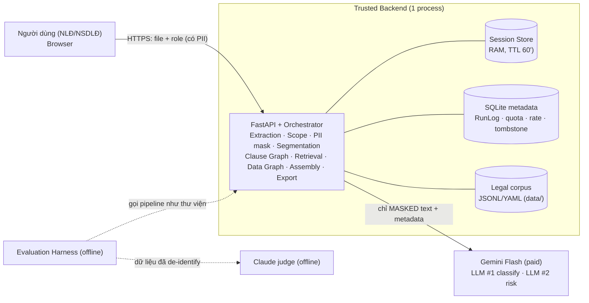
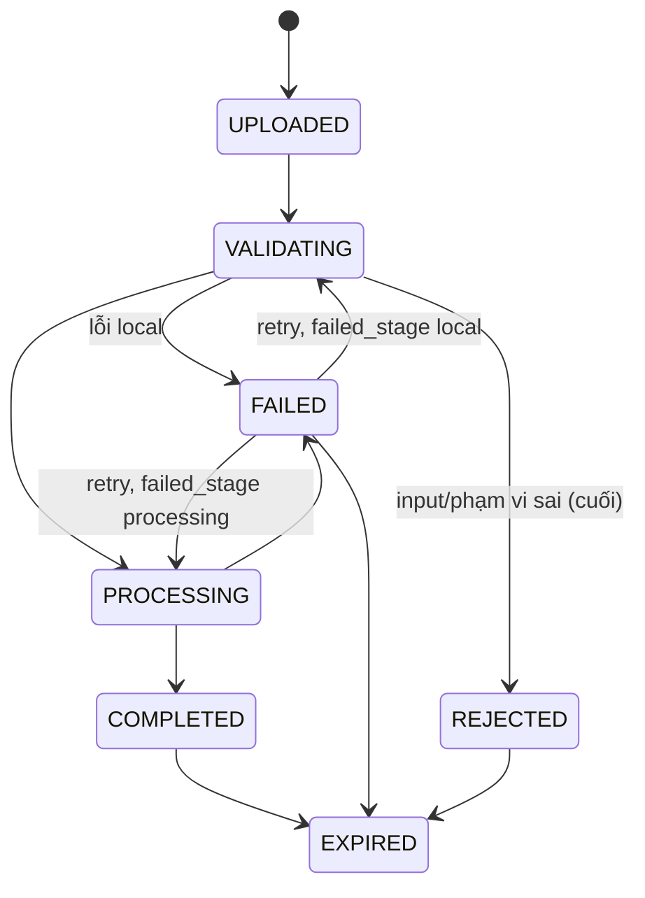

# ARCHITECTURE.md — Kiến trúc tổng quan & Tech stack

> Nguồn: SDD 0.1 + TDD 0.2 (đối chiếu BRD 0.5, SRS 1.4). Mục đích file: nhìn một lần hiểu hệ thống chia thành gì, dữ liệu đi đâu, chạy ở đâu.
> Hàm/API chi tiết: `SKELETON.md`. Kế hoạch: `PROGRESS.md`. Invariant: `AI_CONTEXT.md` §3.
> Những chỗ **không** có trong tài liệu gốc (đề xuất của file này) được đánh dấu **[Đề xuất]**.

## 1. Nguyên tắc kiến trúc

| # | Nguyên tắc | Hệ quả |
|---|---|---|
| 1 | **Modular monolith**, 1 backend, 1 process | Không microservice, không graph DB; module tách theo trách nhiệm. |
| 2 | **Backend sở hữu sự thật** (span, quote, state, citation) | LLM chỉ trả nhãn/giải thích theo `clause_id`; backend ghép lại. |
| 3 | **Chỉ masked text ra ngoài** | PII mask trước segmentation; trust boundary ở backend. |
| 4 | **Closed corpus** | Citation chỉ từ candidate ∈ kho luật ∈ hiệu lực tại ngày phân tích. |
| 5 | **Không lưu bền vững nội dung hợp đồng** | Session RAM; SQLite chỉ metadata. |
| 6 | **Graph là lớp mở rộng** | Tắt Data Graph/Clause Graph vẫn chạy (demo bắt buộc bật Clause Graph). |
| 7 | **Schema-first, version pin** | Mỗi output ghi model/prompt/taxonomy/corpus/extraction version + commit. |

## 2. Bối cảnh hệ thống & trust boundary



| Ranh giới | Được phép đi qua |
|---|---|
| Browser → Backend | File gốc (có PII), qua HTTPS. |
| Backend → Gemini | **Chỉ** masked text + `clause_id` + metadata cần thiết. Không canonical/original/start/end. Không gửi role ở bước classification. |
| Eval → Claude judge | Chỉ dữ liệu đã che/de-identify; judge không nằm trong sản phẩm. |

## 3. Thành phần (component)

| Component | Package đích (TDD §3.2) | Trách nhiệm | Gọi LLM? |
|---|---|---|---|
| Web Frontend | `frontend/` **[Đề xuất]** | Upload, chọn role, polling, hiển thị canonical text + highlight, kết quả, export, disclaimer/data notice. Không tự merge AI result, không tự tính span. | — |
| API / Session Controller | `backend/app/api/` | 6 operation, validate request, pre-admission gate, map lỗi → HTTP. Không có logic AI. | — |
| Analysis Orchestrator | `session/orchestrator.py` | **Nơi duy nhất đổi state**; điều phối stage, batch, retry/resume, version pin, error mapping, cancel. | — |
| Session Store / Lease / Cleanup | `session/` | `InMemorySessionStore`, processing lease (capacity=1), TTL cleanup 60s, tombstone. | — |
| Document Processing | `document/` | PDF (PyMuPDF), DOCX (python-docx+lxml), canonicalize NFC, quality gate (gồm legacy-font TCVN3/VNI). | — |
| Scope Precheck | `document/scope_precheck.py` | Luật từ khóa/cấu trúc xác nhận là HĐLĐ. | Không (DEC-11) |
| PII Masker | `privacy/` | Regex + heuristic; placeholder cùng số code point. | Không |
| Clause Segmenter | `clause/segmenter.py`, `structure_parser.py` | Rule cấu trúc + fallback paragraph; backend tính span. | Không (LLM-assist là cut item 3) |
| Clause Graph | `clause/graph_builder.py`, `context_resolver.py` | NEXT/PARENT_OF/REFERS_TO bằng ID; resolve context ≤3 clause/≤6000 code point. | Không |
| Clause Classification Adapter | `ai/clause_adapter.py` | Batch masked clause → 1–3 nhãn. | **LLM #1** |
| Legal Corpus Manager | `legal/corpus_loader.py`, `corpus_validator.py` | Load/validate, hiệu lực, fail-fast `LEGAL_CORPUS_CONFLICT`. | Không |
| Baseline Retriever | `legal/baseline_retriever.py` | label_map + BM25 (`0.70*label + 0.30*bm25`). | Không |
| Data Graph Service | `legal/data_graph.py` | Mở rộng 1 hop quanh top-3 seed, cap, ranking seed-first; có thể tắt/fallback. | Không |
| Risk Analysis Adapter | `ai/risk_adapter.py` | Risk label, severity, explanation, chọn citation trong candidate; nhận related context. | **LLM #2** |
| Citation Validator | `legal/citation_validator.py` | Candidate ⊂ corpus ⊂ hiệu lực; log số bị loại. | Không |
| Result Assembler | `result/assembler.py` | Join `clause_id`; dựng `risk_basis` từ `basis_type`, tra severity; publish nguyên tử. | Không |
| Report Exporter | `result/exporter.py` | DOCX (bắt buộc), PDF (cut item 4); cùng `ReportModel`. | Không |
| LLM Client | `ai/provider.py`, `gemini_client.py` | `LLMProvider`; timeout 30s; retry matrix; ghi call/token/cost; key qua header. | — |
| Ops | `ops/` | RunLog, daily quota + session reserve, IP rate limit (HMAC), metadata SQLite. | — |
| Evaluation Harness | `ai_pipeline/evaluation/` | M1–M8, privacy, kappa, BL-1; M8 graph on/off; context trace; eval ledger. | Gọi Gemini (pipeline) + Claude (judge) offline |

## 4. Pipeline & state

```text
UPLOAD → EXTRACTION → SCOPE_PRECHECK → PII_MASKING → SEGMENTATION → CLAUSE_GRAPH      ← status VALIDATING
       → CLAUSE_CLASSIFICATION (LLM#1) → LEGAL_RETRIEVAL (baseline + Data Graph)
       → RISK_ANALYSIS (LLM#2 + Clause Graph context) → CITATION_VALIDATION → ASSEMBLY ← status PROCESSING → COMPLETED
```



- Retry: `try_acquire(lease)` → mới `manual_retry_count += 1`; bận → `409 SYSTEM_BUSY`, không tăng counter. Resume theo **fingerprint** SHA-256 (upstream hashes + role + analysis_date + version pins + config version); cut item 2 → chạy lại từ đầu nhưng vẫn giới hạn 2 lần.
- Data Graph lỗi runtime → fallback baseline (`graph_fallback=true` trong RunLog), **không** fail phiên.
- Graph không thêm LLM call. Số call/hợp đồng ≈ `ceil(n/20) + ceil(n/6)` trước retry (40–60 clause ≈ 9–13 call).

## 5. Kiến trúc dữ liệu

| Dữ liệu | Nơi | Vòng đời |
|---|---|---|
| File gốc | Temp dir ngẫu nhiên theo session (chỉ khi parser cần path) | Xóa khi cleanup/end |
| canonical/masked text, clauses, Clause Graph, AI output, `pii_spans` (start/end/type) | `InMemorySessionStore` | TTL 60' không hoạt động hoặc End Session; restart = mất |
| RunLog, usage/quota, rate counter (key IP = HMAC-SHA256 có salt), EXPIRED tombstone (24h) | SQLite (`sqlite3`) | Metadata thuần, **cấm** nội dung/PII |
| Legal corpus + edges + label_map + taxonomy/rubric | `data/` (file versioned, **[Đề xuất theo quyết định nhóm]** repo riêng của Người 2, gắn bằng git submodule) | Load lúc startup; cập nhật không sửa code |
| Eval artifacts (gold, run output, `eval_cost_ledger`) | `ai_pipeline/evaluation/` | Không bị session cleanup xóa; dữ liệu đã de-identify |
| Polling Get Status | không cập nhật `last_activity_at` | Result/Retry/Export/End/Create thì có |

## 6. Hai đồ thị

| | **Data Graph** (BR-17, FR-30) | **Clause Graph** (BR-18, FR-31) |
|---|---|---|
| Mục đích | Retrieval & fact-finding: mở rộng/xếp hạng candidate | Validation & reasoning: điều kiện/phụ thuộc/mâu thuẫn |
| Nút | `LegalProvision` (`citation_id`) | `clause_id` |
| Cạnh | `PARENT_OF` (AUTO, từ `parent_path`); `REFERS_TO`, `GUIDES` (MANUAL, đã xác minh) | `NEXT`, `PARENT_OF`, `REFERS_TO` (chỉ dẫn chiếu nội bộ, resolve duy nhất) |
| Nguồn cạnh | `edges.jsonl` (verified); `edge_suggestions.jsonl` **không load** | Dựng local từ segmentation + regex tham chiếu |
| Mở rộng | 1 hop; ≤4 neighbor/seed, ≤2 child/seed; `graph_score = 0.60*seed.score + edge_bonus(REFERS_TO .30, GUIDES .25, PARENT_OF .15) + direction_bonus(.05)` | Ưu tiên REFERS_TO → PARENT_OF → NEXT; ≤3 clause, ≤6000 code point |
| Kết quả | Cùng `final_k=8` cho graph on/off (EV-08/M8 công bằng) | Masked related context vào Risk request; `ContextResolutionTrace` (ID-only, dev/eval) |
| Bật/tắt | `DATA_GRAPH_ENABLED` | `CLAUSE_GRAPH_ENABLED` (demo bắt buộc true) |
| Vòng đời | Process-wide, build lúc startup | Theo session, xóa cùng phiên |
| Cắt khi trễ (cut 5) | Bỏ `REFERS_TO`/`GUIDES`, giữ cấu trúc | Bỏ `REFERS_TO`, giữ cấu trúc |

Loại trừ dẫn chiếu pháp luật khỏi `REFERS_TO` (Clause Graph): không tạo cạnh nếu ngữ cảnh có `Bộ luật`, `Luật`, `Nghị định`, `Thông tư`, `văn bản pháp luật` hoặc dạng `Điều 26 (của) Bộ luật…`; mơ hồ → bỏ cạnh + diagnostic.

## 7. Tích hợp LLM

- `LLMProvider` (Protocol): `generate_structured(model_id, messages, response_schema, timeout_s)`.
- `GeminiProductClient`: demo/eval, **paid tier**, model id bắt buộc, `response_schema`, temperature 0.0, key qua header. `DevLocalClient`/Gemini free: chỉ `APP_ENV=dev` và dữ liệu de-identify.
- Retry: timeout/network, 429 (backoff+jitter), 5xx, schema-invalid → tối đa 1; 400/401/403 → không. Mỗi *actual request* tăng counter/cost.
- Risk request dùng **candidate catalog** chung (không lặp full text điều luật mỗi item); `candidate_ids` theo thứ tự từng item.
- Sau LLM#2: lint advice theo cụm ("bạn nên", "NLĐ nên", "nên sửa/bổ sung/thương lượng"…, **không** match từ "nên" đơn lẻ) + lint tham chiếu pháp luật ngoài citation → retry ≤1 → xóa câu vi phạm → rỗng thì `AI_OUTPUT_INVALID`.

## 8. Runtime & triển khai

- **1 Uvicorn worker**, không autoscale/serverless (session + lease là process-local). Smoke test fail nếu demo profile cấu hình >1 worker.
- CPU nặng (PyMuPDF, DOCX/OOXML, regex) trong threadpool có giới hạn; `GET status` vẫn ≤2s.
- Startup (fail-fast): load config → taxonomy/rubric → corpus + validate (overlap hiệu lực, endpoint cạnh, PARENT_OF acyclic) → BM25 + label_map + Data Graph → SQLite → Session store + lease + cleanup → threadpool → `readiness=true`.
- Hosting: 1 web frontend + 1 backend service, có HTTPS, temp storage, đọc được corpus. Chưa chọn nhà cung cấp (SDD không khóa).
- Hiệu năng mục tiêu: 90% run (PDF ≤15 trang hoặc DOCX ≤50.000 ký tự) ≤120s; UI thấy VALIDATING/PROCESSING ≤2s. Không cam kết 120s cho input tối đa 150 clause. Benchmark D1 (p50/p90 từng stage) trước MS-2.
- Chi phí: $20 = $5 vận hành + $15 đánh giá; `DAILY_LLM_CALL_QUOTA`, `SESSION_CALL_RESERVE` (= p95 planned calls) chốt từ đo D1; IP limit mặc định 5 upload/10'.

## 9. Bảo mật & riêng tư (tóm tắt)

HTTPS · session_id UUIDv4 opaque, tra cứu chính xác (có test âm) · hard byte cap + sniff type + temp dir ngẫu nhiên + sanitize tên file · secrets qua ENV/header, không log · outbound capture test (không PII/canonical) · quét log tự động tìm PII · audit DB/temp/restart không có nội dung · demo không mật khẩu. PII auto-mask không đạt 100% → thông báo không cam kết tuyệt đối (BRD Phụ lục A). Chưa xác nhận văn bản pháp luật bảo vệ dữ liệu cá nhân khi gửi ra nước ngoài (BRD OI-03).

## 10. Tech stack

| Lớp | Công nghệ | Ghi chú |
|---|---|---|
| Runtime | Python 3.12 | Chung cho `backend/` và `ai_pipeline/` |
| HTTP | FastAPI + Uvicorn (1 worker) | multipart upload, streaming export |
| Schema | Pydantic v2 + JSON Schema | `schemas/*.json` versioned; sinh enum từ code hoặc test đối chiếu |
| PDF | PyMuPDF | reading order, header/footer, bảng, 2 cột |
| DOCX | python-docx + lxml (OOXML) | numbering, tracked changes, textbox |
| Unicode | `unicodedata` (NFC) | offset = code point |
| Lexical retrieval | `rank-bm25` | deterministic, local; embedding **tắt** mặc định |
| Graph | dict/list adjacency in-memory | 1 hop |
| Metadata | `sqlite3` (stdlib) | RunLog/quota/rate/tombstone |
| LLM sản phẩm | Gemini Flash (paid), model id cấu hình tường minh | structured output |
| LLM judge | Claude (offline, chỉ đánh giá) | model cụ thể: BRD OI-11 |
| Export | python-docx (DOCX trước); PDF renderer tùy môi trường | font hỗ trợ tiếng Việt |
| Test | pytest + pytest-asyncio | unit/contract/integration/E2E mock/provider smoke/eval |
| Eval | Python CLI + JSON/CSV | `python -m ai_pipeline.evaluation.runner …` |
| Frontend | **Chưa khóa** (TDD §3.2). **[Đề xuất]** React + TypeScript + Vite, desktop (Chrome/Edge/Firefox) | Contract bắt buộc ở TDD §5.9 (polling, code point→UTF-16, catalog thông báo) |
| Loại bỏ | PostgreSQL/SQLAlchemy/Alembic (cho nội dung hợp đồng), Qwen/Ollama ở product path, Gemini free ở demo/eval | DEC-16, DEC-19 |

## 11. Cấu trúc repository đích

```text
backend/app/{main.py, api/, core/, domain/, session/, document/, privacy/, clause/, ai/, legal/, result/, ops/}
ai_pipeline/{schemas/, evaluation/{runner.py, metrics/, gold/}}
data/{legal_corpus/{manifest.yaml, provisions.jsonl, edges.jsonl, edge_suggestions.jsonl, label_map.yaml},
      docs/{clause_taxonomy/, risk_taxonomy/, severity_rubric/}}
frontend/                      # [Đề xuất]
tests/{unit/, integration/, contract/, fixtures/}
docs/                          # BRD, SRS, SDD, TDD (gốc)  →  docs/splitted_docs/ (sinh bằng scripts/split_doc.py)
scripts/split_doc.py           # tách tài liệu cho AI đọc đỡ token
```

## 12. Quyết định kiến trúc chính (rút gọn; đầy đủ: TDD-01…TDD-25, SRS DEC-01…DEC-28)

Rule-based segmentation, bỏ router theo tỉ lệ heading (DEC-18/TDD-06) · Upload bất đồng bộ, REJECTED luôn gắn session (DEC-23) · `risk_basis` dựng từ `basis_type` của LLM, severity tra bảng (DEC-24/TDD-23) · lease capacity=1, retry acquire lại (DEC-25) · span code point, partition không chồng (DEC-26/TDD-22) · EV-08 cùng `final_k`, M8 chính dùng predicted labels (DEC-27/TDD-10) · 1 worker (DEC-28/TDD-21) · không lưu nội dung bền vững (DEC-16/TDD-02) · Gemini paid cho demo/eval (DEC-19/TDD-25).

## 13. Rủi ro kiến trúc → biện pháp

| Rủi ro | Biện pháp |
|---|---|
| Latency/chi phí LLM | Batching, candidate catalog dedupe, token budget, quota + reserve, benchmark D1 |
| Mất span do mask/segment | Placeholder cùng độ dài, `boundary_guard`, partition, M4=100%, fixture non-BMP |
| Graph làm phình việc kho luật | Graph là lớp tắt được; cạnh cấu trúc tự sinh; `REFERS_TO`/`GUIDES` là cut 5 |
| Session RAM mất khi restart / không scale | Chấp nhận cho demo; 1 worker; nếu cần nhiều worker phải đổi SDD/TDD sang store dùng chung |
| PII local không đạt recall | Đo D1 sớm; thêm local NER **chỉ** nếu BRD §7.3 không đạt (SRS OI-12) |
| Kho luật sai/lỗi thời, không có luật sư | Closed corpus, effectivity, disclaimer, verified edges, báo cáo nêu giới hạn |
| Codebase cũ lệch tài liệu | Schema-first + mock mới trước; migration M0→M6 (`PROGRESS.md`) |
