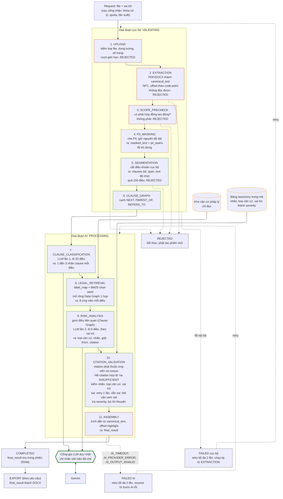

# **SRS: AI Labor Contract Risk Analyzer (phiên bản 1.5)**

Software Requirements Specification. Cơ sở: BRD 0.6 (dự thảo), yêu cầu của giảng viên về Data Graph và Clause Graph, review kỹ thuật ngày 12/10/2026 và các quyết định trong Decision Log.

Oct 13, 2026 · @shdw

## **Kiểm soát tài liệu**

| Phiên bản | Ngày | Thay đổi | Lý do | Người duyệt |
| :---- | :---- | :---- | :---- | :---- |
| 1.1 | 10/10/2026 | Cập nhật theo review SRS 1.0 | Không ghi chi tiết | Không ghi |
| 1.2 | 12/10/2026 | Xem danh sách bên dưới | Review BRD 0.3 và SRS 1.1 ngày 12/10/2026; BRD 0.4; Decision Log | Chủ sở hữu SRS (chờ duyệt) |
| 1.3 | 12/10/2026 | Xem danh sách bên dưới | Yêu cầu của giảng viên (Data Graph, Clause Graph); đối chiếu codebase hiện tại; BRD 0.5 | Chủ sở hữu SRS (chờ duyệt) |
| 1.4 | 13/10/2026 | Xem danh sách bên dưới | Backport review kỹ thuật và TDD 0.2; sửa lifecycle upload/retry, graph evidence, offset và evaluation | Chủ sở hữu SRS (chờ duyệt) |
| 1.5 | 03/11/2026 | Xem danh sách bên dưới | Audit tài liệu ngày 03/11/2026 sau BRD 0.6; tách các điều chỉnh ngày 23/10/2026 (basis\_type, risk taxonomy v0.1) thành phiên bản riêng | Chủ sở hữu SRS (chờ duyệt) |

Thay đổi chính trong 1.5:

* Cơ sở chỉ còn BRD 0.6; không chuyển nội dung cơ chế cài đặt sang TDD. Các điều chỉnh ngày 23/10/2026 (basis\_type, risk taxonomy v0.1) nằm trong phiên bản này.  
* 2.3 và 5: bảng trong risk taxonomy là nguồn duy nhất của severity (rubric chỉ để đọc); INSUFFICIENT\_EVIDENCE áp dụng cho cả ba loại căn cứ; LLM khai evidence\_status, backend hạ xuống khi không còn citation hợp lệ.  
* FR-03 (một lệnh Create/Upload; bỏ mã lỗi SESSION\_NOT\_ACCEPTING\_UPLOAD), FR-10 và NFR-SEC-01 (danh sách che theo BRD 7.2, không lặp số), FR-13 và FR-18 (quy tắc prompt, bản ghi "cần xem xét"), FR-21 và NFR-REL-03 (resume chỉ ở giai đoạn AI), NFR-PERF-01 (đếm mọi phiên).  
* Thêm FR-32 (mâu thuẫn qua related\_clause\_ids), FR-33 (context chung JOB\_INFO và CONTRACT\_TERM\_TYPE); EV-02, EV-05, EV-11; M2b, M9, M10.  
* 6.1: End Session từ VALIDATING và PROCESSING sang EXPIRED. Sơ đồ pipeline ở 2.2 cần vẽ lại theo bộ sơ đồ master (docs/diagrams).

Thay đổi chính trong 1.4:

* Thống nhất Create/Upload theo lifecycle bất đồng bộ: các lỗi admission (thiếu role, SYSTEM_BUSY, quota, rate limit) không tạo phiên; sau khi admission thành công thì tạo session và mọi lỗi file/phạm vi/segmentation chuyển session sang REJECTED, quan sát qua Get Status (FR-02 đến FR-06, FR-09, mục 6 và 9).  
* Làm rõ RiskResult: `risk_labels` vẫn là output AI, còn `risk_basis` được backend suy ra xác định từ risk taxonomy; bổ sung `related_clause_ids` tùy chọn và ContextResolutionTrace để chứng minh Clause Graph thực sự cung cấp context cho Risk stage mà không trao quyền quote/span cho AI (FR-13, FR-31, 4.1, 4.3, EV-09).  
* Sửa retry/state: FAILED do local stage retry về VALIDATING, FAILED do processing stage retry về PROCESSING; retry phải giành lại processing slot atomically, SYSTEM_BUSY không làm tăng retry counter; RETRY_LIMIT_EXCEEDED chỉ dùng cho lần thử thủ công thứ 3 (FR-21, FR-26, 6).  
* Khóa span theo Unicode code point sau NFC và clause span không chồng lấn; bổ sung rule loại trừ dẫn chiếu pháp luật khỏi Clause Graph REFERS_TO và yêu cầu phát hiện PDF font cũ TCVN3/VNI bằng fixture/heuristic chứ không chỉ U+FFFD (FR-08, FR-09, FR-31, NFR-DATA-02/03).  
* Export phải chứa cả disclaimer và data notice; Clause Classification không nhận role; structured output của provider được dùng cho hai LLM stage (FR-11, FR-22, FR-25).  
* Bổ sung các API error phụ (`INVALID_SESSION_STATE`, `SESSION_NOT_READY`, `SESSION_REJECTED`, `SESSION_EXPIRED`, `FEATURE_NOT_ENABLED`) và làm rõ End Session trả xác nhận + EXPIRED (6.2, 9).  
* Sửa EV-08 để M8 graph on/off dùng cùng candidate budget/final_k và primary run dùng predicted clause labels; thêm EV-09 cho Clause Graph context trace và EV-10 tách quota/rate-limit của evaluation khỏi product runtime.  
* Demo runtime dùng một backend worker/process với session store trong memory; mọi actual provider request kể cả auto-retry được tính vào cost/call ledger; quota demo phải chốt từ D1 và cost model thay vì hard-code một con số tùy ý (NFR-SCALE-01, NFR-COST-02).
* Điều chỉnh 23/10/2026 (risk taxonomy v0.1): LLM trả `basis_type` (một giá trị cho mỗi clause) cùng `risk_labels`; backend kiểm (label, basis\_type, vai trò) theo risk taxonomy, tra severity theo bảng taxonomy (LLM không trả severity) và dựng `risk_basis` (DEC-24, FR-13, FR-14, 4.1, 4.3, R-19).

Thay đổi chính trong 1.3:

* Thêm FR-30 (Data Graph, Retrieval & Fact-finding) và FR-31 (Clause Graph, Validation & Reasoning); cập nhật FR-12, FR-24, FR-29, mục 5; thêm R-17, R-18 (DEC-21).  
* Thêm NFR-DATA-04 (không lưu bền vững nội dung hợp đồng), NFR-SEC-06 (nhà cung cấp LLM, cấu hình model), NFR-MAINT-03 (dữ liệu graph) (DEC-16, DEC-19).  
* FR-09, FR-11: làm rõ luật cấu trúc là mặc định và nhãn không kèm điểm tin cậy (DEC-17, DEC-18); FR-08 giới hạn fixture theo hợp đồng thật (OI-11).  
* 4.1, 4.2, 4.3: thêm LegalEdge, ClauseEdge, invariant của graph, stage dựng Clause Graph.  
* Thêm EV-08 (M8 có và không graph). Các tham chiếu BRD 7.3, 7.5, 7.6, 9.4, 9.5 nay có trong BRD 0.5.  
* Thêm DEC-16 đến DEC-22, OI-08 đến OI-12 và Phụ lục C: danh sách thay đổi cần làm ở codebase hiện tại (chỉ ghi nhận, chưa thực hiện).

Thay đổi chính trong 1.2:

* Pipeline và R-04: che dữ liệu cá nhân trên canonical text trước, văn bản đã che có cùng độ dài, tách điều khoản trên văn bản đã che (DEC-01).  
* Bỏ contract\_id và analysis\_id, mọi thao tác theo session\_id; REJECTED là trạng thái cuối; chỉ FAILED được thử lại, tối đa 2 lần (DEC-02, DEC-03).  
* FR-06 chỉ dùng luật cục bộ; FR-08 thêm các ca DOCX và PDF của hợp đồng tiếng Việt; FR-18 và RiskResult dùng evidence\_status, basis\_type, severity có thể null (DEC-12).  
* Thêm FR-26 đến FR-29 (một phiên xử lý tại một thời điểm, trần chi phí, xử lý theo lô, ghim phiên bản).  
* Bỏ NFR-SCALE-01 (5 phiên song song); thêm NFR-REPRO-01 và NFR-COST-02; NFR-SEC-01 theo BRD 7.3.  
* 8 chỉ dẫn ID chỉ số của BRD 8, không lặp ngưỡng; thêm yêu cầu hỗ trợ đánh giá.  
* 6 sửa state machine và mở rộng mã lỗi; 11 truy vết hai chiều; 13 Open Issues; thêm Decision Log bên dưới.

### **Decision Log**

| ID | Quyết định | Ngày | Người chốt | Ảnh hưởng |
| :---- | :---- | :---- | :---- | :---- |
| DEC-01 | Che dữ liệu cá nhân trên toàn canonical text trước khi tách điều khoản; chuỗi thay thế cùng độ dài; tách điều khoản trên văn bản đã che | 12/10/2026 | Nhóm | R-04, FR-09, FR-10, 4 |
| DEC-02 | REJECTED là trạng thái cuối, muốn thử lại phải mở phiên mới; FAILED được thử lại thủ công tối đa 2 lần | 12/10/2026 | Nhóm | 6, FR-21 |
| DEC-03 | Bỏ contract\_id và analysis\_id; một phiên một hợp đồng; mọi thao tác theo session\_id | 12/10/2026 | Nhóm | 4, 9 |
| DEC-04 | Highlight trên canonical text, không overlay lên PDF hoặc DOCX gốc | 12/10/2026 | Nhóm | FR-19; BRD BR-09 |
| DEC-05 | Bỏ yêu cầu 5 phiên song song; một phiên xử lý tại một thời điểm | 12/10/2026 | Nhóm | FR-26 |
| DEC-06 | Evaluation Plan nằm trong BRD 8; SRS chỉ dẫn ID | 12/10/2026 | Nhóm | 8 |
| DEC-07 | Judge dùng Claude, chạy ngoại tuyến, chỉ để chấm; M6 là điều kiện tin judge; judge không nằm trong danh sách cắt | 12/10/2026 | Nhóm | 8 |
| DEC-08 | M5 ≥ 90% với ≥ 30 lỗi chèn; F1 phân loại 0.80 đến khi có số đo dev; không có chỉ số role-differentiation | 12/10/2026 | Nhóm | 8 |
| DEC-09 | Ngân sách \$20: \$5 vận hành, \$15 đánh giá | 12/10/2026 | Nhóm | NFR-COST-01 |
| DEC-10 | Clause taxonomy, risk taxonomy, severity rubric, annotation guideline đóng băng ở MS-1 (25/10/2026) | 12/10/2026 | Nhóm | 2.3 |
| DEC-11 | FR-06 chỉ dùng luật cục bộ, không gọi LLM | 12/10/2026 | Nhóm | FR-06 |
| DEC-12 | Rủi ro thiếu căn cứ được giữ lại với evidence\_status \= INSUFFICIENT\_EVIDENCE, severity null | 12/10/2026 | Nhóm | FR-14, FR-18, 4 |
| DEC-13 | Thứ tự cắt: BL-1, stage resume, LLM hỗ trợ tách điều khoản, export PDF | 12/10/2026 | Nhóm | 3 |
| DEC-14 | 8 tuần kể cả tuần 12/10/2026, hạn demo 06/12/2026 | 12/10/2026 | Nhóm | BRD 9 |
| DEC-15 | Không dùng mật khẩu demo; chống lạm dụng bằng trần call mỗi ngày và giới hạn tần suất theo IP | 12/10/2026 | Nhóm | FR-27 |
| DEC-16 | Nội dung hợp đồng của phiên không lưu ở cơ sở dữ liệu hay kho bền vững; chỉ ở bộ nhớ tiến trình hoặc kho tạm bị xóa theo FR-23. Bỏ PostgreSQL, SQLAlchemy, Alembic cho dữ liệu hợp đồng | 12/10/2026 | Nhóm | NFR-DATA-04, Phụ lục C |
| DEC-17 | Clause chỉ có clause\_labels (1 đến 3 nhãn); bỏ type\_scores, tier rủi ro theo nhãn, review\_zone | 12/10/2026 | Cả nhóm | FR-11, 4.1, Phụ lục C |
| DEC-18 | Tách điều khoản mặc định bằng luật cấu trúc kèm fallback paragraph; bỏ bộ định tuyến theo tỉ lệ dòng tiêu đề | 12/10/2026 | Nhóm | FR-09, Phụ lục C |
| DEC-19 | Demo và đánh giá dùng Gemini Flash gói trả phí; gói miễn phí dùng API Flash không trả phí | 12/10/2026 | Nhóm | NFR-SEC-06, FR-29 |
| DEC-20 | Danh sách nhãn clause có một nguồn duy nhất trong code; enum của JSON Schema sinh từ đó hoặc có test đối chiếu | 12/10/2026 | Nhóm | NFR-MAINT-02 |
| DEC-21 | Thêm Data Graph (phục vụ Retrieval & Fact-finding: tìm kiếm thông tin, truy vấn tri thức) và Clause Graph (phục vụ Validation & Reasoning: kiểm tra mâu thuẫn, suy diễn điều kiện) theo yêu cầu giảng viên; Data Graph là lớp trên retrieval nền, hệ thống chạy được khi tắt graph; thiết kế chi tiết ở SDD và TDD | 12/10/2026 | Nhóm | FR-12, FR-30, FR-31, BRD BR-17, BR-18 |
| DEC-22 | 10 tuần là 8 tuần xây dựng đến demo 06/12/2026 cộng 2 tuần đánh giá và báo cáo; mốc theo BRD 9.4 | 12/10/2026 | Cơ cấu 8+2 tuần đã xác nhận 12/10/2026; Nhóm | BRD 9 |
| DEC-23 | Create/Upload sau admission gate tạo session và trả sớm; các lỗi validate file/phạm vi/segmentation sau đó biểu diễn bằng state REJECTED của chính session đó, không vừa trả lỗi đồng bộ vừa có session | 13/10/2026 | Nhóm | FR-02..06, FR-09, 6, 9 |
| DEC-24 | LLM trả `risk_labels` và một `basis_type` cho mỗi clause; backend kiểm (label, basis\_type, vai trò) theo risk taxonomy rồi dựng `risk_basis`; severity do backend tra bảng taxonomy, LLM không trả; Clause Graph cung cấp related context cho Risk stage và có ContextResolutionTrace; `related_clause_ids` trong RiskResult là tùy chọn, nếu có phải là tập con của context đã cấp | 13/10/2026 | Nhóm | FR-13, FR-31, 4, EV-09 |
| DEC-25 | Processing slot capacity=1 phải acquire atomically ở admission và acquire lại khi manual retry; FAILED local retry về VALIDATING, FAILED processing retry về PROCESSING; SYSTEM_BUSY không tăng retry counter | 13/10/2026 | Nhóm | FR-21, FR-26, 6 |
| DEC-26 | Mọi span dùng Unicode code point sau NFC; clause spans không chồng lấn. Với cấu trúc cha-con, phần text của clause cha kết thúc trước phần body thuộc clause con | 13/10/2026 | Nhóm | FR-09, 4.2, NFR-DATA-02 |
| DEC-27 | EV-08 so graph on/off với cùng final candidate budget và primary M8 dùng predicted clause labels; evaluation bypass runtime quota/rate-limit nhưng ghi cost ledger riêng | 13/10/2026 | Nhóm | FR-12, FR-30, EV-08, EV-10 |
| DEC-28 | Demo deploy một backend worker/process, không autoscale/serverless, vì session store và processing slot là process-local; CPU-heavy local work không được làm block status polling | 13/10/2026 | Nhóm | NFR-SCALE-01, NFR-PERF-02, NFR-DATA-04 |

## **1\. Giới thiệu**

### **1.1 Mục đích tài liệu**

Tài liệu đặc tả yêu cầu phần mềm của AI Labor Contract Risk Analyzer ở mức đủ để làm căn cứ cho thiết kế hệ thống (SDD), thiết kế kỹ thuật (TDD), triển khai, chia việc và kiểm thử. Input là BRD 0.5. Ngưỡng và cách đo mọi chỉ số chất lượng nằm ở BRD 8; SRS chỉ dẫn ID.

### **1.2 Phạm vi sản phẩm**

* Web app cho máy tính, giao diện tiếng Việt, không yêu cầu đăng ký tài khoản.

* Mỗi phiên gắn với đúng một vai trò (NLĐ hoặc NSDLĐ) và một hợp đồng.

* Đầu vào: HĐLĐ tiếng Việt dạng PDF hoặc DOCX có sẵn text, đã soạn đầy đủ điều khoản và chưa ký.

* Hệ thống chỉ phân tích rủi ro phát sinh từ các điều khoản thực sự có trong hợp đồng.

* Kết quả gồm điều khoản rủi ro, risk label, severity HIGH, MEDIUM hoặc LOW, giải thích, căn cứ luật và highlight trên canonical text.

* Data Graph (đồ thị kho luật, phục vụ Retrieval & Fact-finding) và Clause Graph (đồ thị điều khoản của hợp đồng trong phiên, phục vụ Validation & Reasoning), theo yêu cầu của giảng viên (DEC-21).

* Kết quả chỉ mang tính tham khảo, không phải tư vấn pháp lý.

### **1.3 Ngoài phạm vi**

* Phát hiện rủi ro do thiếu hoàn toàn một điều khoản bắt buộc (missing-clause risk).

* Chatbot hoặc hỏi đáp sau khi có kết quả.

* Lời khuyên pháp lý, gợi ý sửa điều khoản hoặc đề xuất thương lượng.

* PDF scan, ảnh chụp, OCR; hợp đồng không phải tiếng Việt.

* Highlight đè trực tiếp lên PDF hoặc DOCX gốc (DEC-04).

* Xử lý nhiều phiên song song (DEC-05).

* Tài khoản người dùng, lịch sử lâu dài, thanh toán, mobile app, giao diện tiếng Anh.

* Tự huấn luyện, fine-tune hoặc self-host mô hình.

* Yêu cầu quy mô hay độ ổn định production.

### **1.4 Thuật ngữ**

| Thuật ngữ | Ý nghĩa |
| :---- | :---- |
| Phiên | Một lần làm việc với một vai trò và một hợp đồng, định danh bằng session\_id (BRD Phụ lục B). |
| Canonical text | Chuỗi văn bản chuẩn duy nhất sinh từ tài liệu, Unicode NFC; dùng cho tách điều khoản, span, lưu trữ, highlight và export. |
| Masked text | Bản của canonical text sau khi che dữ liệu cá nhân, có cùng độ dài ký tự; chỉ bản này được gửi cho LLM bên thứ ba. |
| Placeholder | Chuỗi ký tự thay thế một đoạn dữ liệu cá nhân, cùng độ dài với đoạn bị thay. |
| Clause | Một điều khoản do bước tách điều khoản sinh ra, có clause\_id, original\_text và span. |
| Span | Cặp start\_char (bao gồm) và end\_char (không bao gồm) trên canonical text, tính theo Unicode code point sau NFC. Vì masked text cùng độ dài theo code point nên cùng span áp dụng cho cả hai. |
| Clause taxonomy | Tập 12 nhãn mô tả loại điều khoản. Tách biệt với risk taxonomy. |
| Risk taxonomy | Tập nhãn mô tả loại rủi ro theo vai trò. Taxonomy khai báo severity theo (nhãn, basis\_type, vai trò); basis\_type (LEGAL\_VIOLATION, UNFAVORABLE hoặc AMBIGUOUS) là loại căn cứ của rủi ro trên một clause, do LLM chọn. Một clause có thể có nhiều risk label. |
| Kho luật | Nguồn đóng (closed corpus) duy nhất mà hệ thống được phép trích dẫn. |
| Candidate | Điều luật do retriever cung cấp cho một clause; LLM chỉ được chọn citation trong danh sách candidate. |
| Evidence status | SUPPORTED nếu có căn cứ từ candidate; INSUFFICIENT\_EVIDENCE nếu thiếu căn cứ. |
| Data Graph | Đồ thị trên kho luật: nút là LegalProvision, cạnh là LegalEdge (cấu trúc, dẫn chiếu, hướng dẫn thi hành). Phục vụ Retrieval & Fact-finding: mở rộng và xếp hạng candidate (FR-12, FR-30). |
| Clause Graph | Đồ thị trên các clause của một phiên: nút là clause\_id, cạnh là ClauseEdge. Tạo cục bộ, chỉ chứa ID và loại cạnh, xóa cùng phiên. Phục vụ Validation & Reasoning bằng cách chọn related clauses làm context cho Risk stage; không có quyền sửa quote/span (FR-31). |
| ContextResolutionTrace | Artifact chẩn đoán/evaluation chỉ chứa target clause\_id, related clause\_ids, loại quan hệ và graph flag; không chứa contract text. Dùng để chứng minh Clause Graph đã cung cấp context cho Risk stage (EV-09). |
| Retrieval nền | Truy xuất không dùng graph (bảng ánh xạ nhãn sang điều luật cộng tìm kiếm văn bản). Graph chỉ mở rộng trên kết quả của retrieval nền. |

## **2\. Mô tả tổng quan và quyết định thiết kế**

### **2.1 Actors**

| Actor | Vai trò | Nghiệp vụ |
| :---- | :---- | :---- |
| Người lao động (NLĐ) | Người dùng cuối | Phân tích các điều khoản hiện có theo góc nhìn NLĐ. |
| Người sử dụng lao động (NSDLĐ) | Người dùng cuối | Phân tích các điều khoản hiện có theo góc nhìn NSDLĐ. |
| Người phụ trách dữ liệu | Thành viên nhóm phát triển | Duy trì kho luật, metadata hiệu lực, các taxonomy và guideline liên quan. |

### **2.2 Pipeline bắt buộc**

Sơ đồ dưới là pipeline của sản phẩm. Các quy tắc sau áp dụng cho mọi thiết kế chi tiết ở SDD và TDD (pipeline có thể được refine ở SDD, xem OI-01, miễn không đổi các quy tắc này):

pipeline sản phẩm · 10 bước, 2 bước gọi LLM

Hai bước tô màu là các lần gọi LLM bên thứ ba; các bước còn lại chạy trong hệ thống của nhóm.

* LLM bên thứ ba không được nhận canonical text chưa che.  
* LLM không được tạo hoặc chỉnh start\_char, end\_char và không được tạo quote để highlight.  
* Mọi output AI downstream phải tham chiếu clause\_id; backend là nơi ghép kết quả với original\_text và span từ canonical text.  
* Invariant: canonical\_text\[start\_char:end\_char\] \== original\_text; len(masked\_text) \== len(canonical\_text); masked\_text\[start\_char:end\_char\] là clause đã che.  
* Sản phẩm có hai bước LLM bắt buộc: Clause Classification, và Risk + Explanation + chọn citation (severity do backend tra bảng taxonomy). Bước LLM hỗ trợ tách điều khoản là tùy chọn (hạng mục cắt số 3). Judge chạy ngoại tuyến, không thuộc pipeline sản phẩm.  
* Legal Retrieval chạy cục bộ, không gọi LLM.
* Legal Retrieval gồm retrieval nền và bước mở rộng qua Data Graph (FR-12, FR-30). Tắt bước mở rộng thì hệ thống vẫn chạy đúng.
* Clause Graph được dựng cục bộ ngay sau Segmentation, không gọi LLM và không thêm bước LLM (FR-31). Context Resolver lấy các clause liên quan từ graph và chỉ gửi masked related context vào Risk LLM; output vẫn gắn target clause\_id. Sơ đồ trên chưa vẽ Graph vì đây là chi tiết local đã được refine ở SDD/TDD.

### **2.3 Taxonomy và severity**

* Clause taxonomy (12 nhãn) và risk taxonomy nằm ở docs/CLAUSE\_TAXONOMY.md và docs/RISK\_TAXONOMY\_v0.1.md. Hai artifact tách biệt, có phiên bản, và được đóng băng cùng severity rubric và annotation guideline theo DEC-10 (mốc MS-1 25/10/2026 đã trễ, xem BRD 9.4).  
* Severity: HIGH, MEDIUM, LOW. Bảng trong risk taxonomy là nguồn duy nhất của severity; rubric bên dưới chỉ để đọc. Severity có thể khác nhau giữa hai vai trò và là null khi evidence\_status \= INSUFFICIENT\_EVIDENCE.  
* Điều khoản có lợi hơn mức pháp luật yêu cầu cho một vai trò không phải rủi ro của vai trò đó (BRD 3.2).

| Severity | Rubric tối thiểu (theo vai trò đang phân tích) |
| :---- | :---- |
| HIGH | Điều khoản trực tiếp xung đột quy định cấm hoặc bắt buộc, hoặc vượt ngưỡng pháp luật rõ ràng trong kho luật; hoặc tạo nguy cơ mất quyền hay nghĩa vụ trái luật đáng kể. |
| MEDIUM | Điều khoản có dấu hiệu bất lợi đáng kể, mơ hồ hoặc có khả năng dẫn đến tranh chấp nhưng không thỏa điều kiện HIGH theo căn cứ hiện có. |
| LOW | Vấn đề mức độ nhẹ, câu chữ chưa rõ hoặc bất lợi hạn chế; tác động pháp lý thấp theo căn cứ hiện có. |

## **3\. Yêu cầu chức năng**

Tất cả yêu cầu là bắt buộc cho bản demo, trừ phần có ghi số ở cột Cắt, là thứ tự cắt theo BRD 9.5 (số 1 là BL-1, không nằm trong bảng này). ID giữ nguyên so với SRS 1.1; FR-10 chạy trước FR-09. Mỗi tiêu chí nghiệm thu kiểm thử được bằng test case, log hoặc minh chứng demo.

| ID | Yêu cầu | Chi tiết và quy tắc | Tiêu chí nghiệm thu | Cắt |
| :---- | :---- | :---- | :---- | :---- |
| FR-01 | Chọn vai trò | Người dùng chọn NLĐ hoặc NSDLĐ trước khi upload. Vai trò gắn với phiên và không đổi. | Không upload được khi thiếu vai trò (ROLE\_REQUIRED); mọi stage downstream nhận cùng vai trò. |  |
| FR-02 | Khởi tạo phiên | Create/Upload request chỉ tạo session sau khi qua admission gate: role hợp lệ, processing slot còn trống, quota và rate limit cho phép. Khi gate pass, backend tạo session\_id opaque/ngẫu nhiên, gắn đúng một vai trò và một file, rồi có thể trả response trước khi hoàn tất VALIDATING. Các lỗi file/phạm vi/segmentation phát hiện sau đó chuyển chính session sang REJECTED; REJECTED kết thúc phiên. Không có contract\_id (DEC-03, DEC-23). | Các lỗi ROLE\_REQUIRED, SYSTEM\_BUSY, QUOTA\_EXCEEDED, RATE\_LIMITED không tạo session. Session đã tạo có thể chuyển REJECTED và error\_code được đọc qua Get Status. session\_id không đoán được; không nhận file thứ hai. |  |
| FR-03 | Upload file | Nhận đúng một PDF hoặc DOCX trong cùng request Create/Upload tạo phiên (một lệnh duy nhất, mục 9). Kiểm tra type có thể chạy trong VALIDATING; type không hỗ trợ chuyển session sang REJECTED. | PDF hoặc DOCX hợp lệ tiếp tục pipeline; định dạng khác có session state REJECTED với UNSUPPORTED\_FILE\_TYPE. |  |
| FR-04 | Validate dung lượng và độ dài | PDF tối đa 10MB và 30 trang. DOCX tối đa 10MB và 100.000 ký tự canonical (ngưỡng chốt theo BRD OI-12). | Test biên tại ngưỡng và vượt ngưỡng; file vượt giới hạn bị REJECTED trước khi gọi LLM. |  |
| FR-05 | Kiểm tra khả năng trích text | Từ chối scan, image-only, hoặc text extraction lỗi hay không đọc được. Canonical text là Unicode NFC. | Bộ test có text pass; scan và mẫu text rác bị REJECTED với mã lỗi phù hợp. |  |
| FR-06 | Kiểm tra có phải HĐLĐ | Kiểm tra phạm vi bằng luật cục bộ trên canonical text (từ khóa và cấu trúc điển hình); không gọi LLM (DEC-11). HĐLĐ, hợp đồng thử việc và phụ lục trong cùng file thuộc phạm vi. Tín hiệu tiêu đề mạnh chỉ được tính khi xuất hiện ở vùng tiêu đề/đầu tài liệu theo cấu hình TDD; chỉ nhắc cụm “hợp đồng lao động” trong thân văn bản không đủ để chấp nhận. | Bộ test cố định có tài liệu dương và âm, gồm ca chỉ nhắc HĐLĐ trong thân văn bản. Tài liệu ngoài phạm vi chuyển session sang REJECTED (NOT\_LABOR\_CONTRACT) và không chạy bước sau. |  |
| FR-07 | Sinh canonical text | Parser tạo một canonical\_text ổn định, giữ thứ tự đọc và newline cần cho ranh giới điều khoản; normalization theo Text Extraction Contract (TDD). | Cùng file và cùng extraction\_version sinh cùng canonical\_text; NFC; không gộp newline cấu trúc. |  |
| FR-08 | Bảng, header, footer và các ca của hợp đồng tiếng Việt | Bảng làm phẳng theo từng dòng, giữ nội dung ô; header, footer, số trang lặp không chen vào giữa clause. DOCX: đánh số tự động ("Điều 1", "1.1") được render thành text; chấp nhận mọi tracked change; bỏ comment và footnote; đọc text box theo vị trí. PDF: hai cột đọc theo thứ tự cột; PDF font cũ (TCVN3, VNI) bị từ chối theo NFR-DATA-03 kể cả khi text extract ra vẫn là Unicode hợp lệ nhưng mojibake. | Mỗi ca có fixture và canonical text đúng thứ tự đọc theo expected output; fixture TCVN3/VNI phải bị từ chối. Các kiểu đánh số tự động cần hỗ trợ được chốt theo hợp đồng thực có trong D1 và T1 (OI-11); kiểu ngoài danh sách đó phải ghi vào giới hạn đã biết. |  |
| FR-09 | Clause Segmentation và span | Chạy trên masked\_text trong trusted backend bằng luật cấu trúc (regex theo "Điều n", "n.n", chữ cái, gạch đầu dòng) kèm fallback theo paragraph khi không có tiêu đề. Backend tự tính clause\_id, start\_char, end\_char theo Unicode code point sau NFC; original\_text lấy từ canonical\_text. Các clause span phải có thứ tự và không chồng lấn; một ký tự thuộc vùng clause không được thuộc đồng thời clause cha và clause con. Với cấu trúc cha-con, clause cha chỉ giữ heading/lời dẫn trước child đầu tiên, còn body của child thuộc span child. Ranh giới không cắt ngang placeholder. Vượt 150 clause thì REJECTED (TOO\_MANY\_CLAUSES). Luật cấu trúc là đường xử lý mặc định; không router theo tỉ lệ heading (DEC-18). Tùy chọn LLM segmentation vẫn là cut item 3. | 100% clause có canonical\_text\[start:end\] \== original\_text; spans sorted/non-overlap; không boundary trong placeholder; fixture nested Điều/Khoản, không tiêu đề, hybrid, điều khoản dài và ký tự non-BMP. | 3 (phần LLM hỗ trợ) |
| FR-10 | PII Masking | Chạy cục bộ trên toàn canonical\_text, trước FR-09: phát hiện họ tên (kể cả người đại diện), ngày sinh, CCCD hoặc hộ chiếu, mã số thuế, ngày và nơi cấp giấy tờ, địa chỉ cư trú và địa chỉ trụ sở, số điện thoại, email, số tài khoản, tên pháp nhân (ẩn nguyên cụm), chữ ký và thay mỗi đoạn bằng placeholder cùng độ dài; masked\_text có cùng độ dài canonical\_text. Giữ nguyên các trường cần giữ (lương, phụ cấp, thời hạn, thời giờ, chức danh, chức vụ đại diện NSDLĐ, tỉnh khi đứng riêng, từ chỉ vai trò). Không dùng LLM bên thứ ba. Không lưu giá trị gốc của đoạn đã che ngoài canonical\_text. | Capture hoặc mock payload gửi ra không chứa PII gold trong bộ privacy test; đạt ngưỡng BRD 7.3; len(masked\_text) \== len(canonical\_text); không tồn tại bảng ánh xạ placeholder sang giá trị. |  |
| FR-11 | Clause Classification | Phân loại theo clause taxonomy đã đóng băng. Input chỉ gồm clause\_id và masked clause, kèm ngữ cảnh cấu trúc tối thiểu nếu cần; **không gửi role** để tránh làm lệch taxonomy. Xử lý theo lô (FR-28). Provider structured output/response schema được dùng để ép schema. Output chỉ tham chiếu clause\_id và 1 đến 3 nhãn; không confidence/type\_scores/tier/review\_zone (DEC-17). | Output chỉ chứa nhãn hợp lệ; request không có role/original/span; không trả hoặc ghi đè span, quote. |  |
| FR-12 | Legal Retrieval | Từ masked clause, clause labels và vai trò, truy xuất candidate từ kho luật. Kho luật chia thành đơn vị trích dẫn được (văn bản, điều, khoản, điểm). Hai tầng: retrieval nền tạo seed; bước mở rộng và xếp hạng qua Data Graph (FR-30) trong giới hạn số candidate cấu hình được. Tắt mở rộng thì retrieval nền vẫn trả kết quả. | Mỗi candidate có citation\_id hợp lệ, nội dung và metadata hiệu lực; không có candidate ngoài kho; đo M8 trên T2, có và không mở rộng graph (EV-08). |  |
| FR-13 | Risk Classification | Phân loại theo risk taxonomy theo từng clause và vai trò. Risk LLM chọn `risk_labels` và một `basis_type` cho mỗi clause (LEGAL\_VIOLATION, UNFAVORABLE hoặc AMBIGUOUS). Backend kiểm (label, basis\_type, vai trò) theo taxonomy (tổ hợp không phải rủi ro của vai trò thì gỡ nhãn) rồi dựng `risk_basis=[{label,basis_type}]` một-một với `risk_labels`. Risk stage có thể nhận related masked clauses do Clause Graph Context Resolver cung cấp. Không phát hiện missing-clause risk. Định nghĩa ba loại căn cứ theo vai trò nằm ở annotation guideline và risk taxonomy (BRD 3.2). LLM chỉ gắn LEGAL\_VIOLATION khi đối chiếu được nội dung clause với điều luật trong candidate; nghi ngờ LEGAL\_VIOLATION mà không có candidate phù hợp thì vẫn gắn LEGAL\_VIOLATION kèm evidence\_status INSUFFICIENT\_EVIDENCE (FR-18). Khi hai clause trong context mâu thuẫn nhau thì đặt basis\_type AMBIGUOUS, điền `related_clause_ids` và nêu mâu thuẫn trong giải thích (FR-32). Tổ hợp (label, basis\_type, vai trò) sai sau một lần retry có phản hồi thì phát bản ghi "nghi ngờ, cần xem xét" với severity null, không bỏ clause. Giải thích viết tên văn bản khi nhắc điều luật (ví dụ "Điều 97 Bộ luật Lao động 2019"), gọi điều khoản hợp đồng là "điều khoản số N của hợp đồng", và nhắc điểm của khoản bằng lời, không chép lại nội dung điểm. | Mỗi risk gắn clause\_id, vai trò và risk label hợp lệ; `risk_basis` khớp 100% taxonomy; không có risk không có clause\_id. |  |
| FR-14 | Severity | Backend gán HIGH, MEDIUM hoặc LOW bằng cách tra bảng risk taxonomy theo (nhãn, basis\_type, vai trò), lấy mức cao nhất khi có nhiều nhãn; LLM không trả severity. Có thể khác giữa hai vai trò. Với INSUFFICIENT\_EVIDENCE, severity là null. | Severity thuộc enum cho phép hoặc null đúng quy tắc; ca thiếu căn cứ không trình bày như kết luận chắc chắn. |  |
| FR-15 | Legal Citation | AI chỉ chọn citation trong candidate list, không tự sinh điều luật. Backend xác minh citation\_id tồn tại, thuộc kho luật, đúng phiên bản hiệu lực tại ngày phân tích; citation không hợp lệ bị loại, và số bị loại được log trước khi lọc. | M3a \= 100%; số citation bị loại được ghi lại cho BRD 8.3. |  |
| FR-16 | Relevance của citation | Citation phải hỗ trợ nội dung risk và giải thích, không chỉ tồn tại. Hệ thống lưu evidence snippet (nội dung candidate) để rà soát. | Mẫu 40 output chấm tay theo rubric relevance (M3b); citation tồn tại nhưng không liên quan tính là sai. |  |
| FR-17 | Explanation | Giải thích ngắn vì sao clause là rủi ro theo vai trò, dựa trên căn cứ đã chọn. Không có lời khuyên sửa hay đàm phán. Advice lint phải dựa trên cụm/hành vi khuyến nghị đầy đủ, không được coi riêng từ nối như “nên” trong câu giải thích là vi phạm. Nếu output có advice, hệ thống được correction/sanitize tối đa một lần; chỉ fail khi sau xử lý không còn explanation hợp lệ. | Mẫu chấm tay không có advice; lint fixture không false-positive câu giải thích hợp lệ; explanation không viện dẫn điều luật ngoài citation hợp lệ. |  |
| FR-18 | Thiếu căn cứ | Nếu kho luật hoặc retrieval không đủ căn cứ, hệ thống không tự suy ra citation. Bản ghi được giữ với evidence\_status \= INSUFFICIENT\_EVIDENCE, citation\_ids rỗng, severity null (DEC-12). Áp dụng cho cả LEGAL\_VIOLATION, UNFAVORABLE và AMBIGUOUS; backend hạ evidence\_status xuống INSUFFICIENT\_EVIDENCE khi không còn citation hợp lệ sau khi lọc. Giao diện hiển thị "có thể có rủi ro, chưa đủ căn cứ trong kho luật, cần đọc kỹ", không dùng từ khẳng định vi phạm (FR-14). | Không có fabricated citation; giao diện thể hiện rõ "chưa đủ căn cứ". |  |
| FR-19 | Kết quả và highlight | Backend ghép output AI theo clause\_id với original\_text và span từ canonical\_text. Giao diện highlight trên canonical text, không overlay lên PDF hoặc DOCX gốc (DEC-04), và ghi rõ đây là bản văn bản trích xuất. | Bấm vào highlight cho đúng substring; M4 \= 100%; giao diện có dòng giải thích. |  |
| FR-20 | Không phát hiện risk | Nếu không có risk hợp lệ, hiển thị "không phát hiện rủi ro trong phạm vi phân tích" kèm disclaimer; không khẳng định hợp đồng an toàn. | Ca không risk trả COMPLETED kèm disclaimer, không báo lỗi. |  |
| FR-21 | Retry và resume | Auto-retry mỗi provider request tối đa 1 lần theo NFR-REL-02. Chỉ phiên FAILED được manual retry, tối đa 2 lần; REJECTED không retry. Manual retry phải acquire lại processing slot trước khi tăng `manual_retry_count`; nếu slot bận trả SYSTEM\_BUSY và counter không đổi. Nếu failed stage thuộc VALIDATING thì retry quay lại VALIDATING; nếu failed stage thuộc PROCESSING thì quay lại PROCESSING. Resume chỉ áp dụng cho giai đoạn PROCESSING: chạy lại từ stage AI lỗi nếu bộ version pin lưu trong phiên khớp bộ hiện tại; retry giai đoạn VALIDATING luôn chạy lại từ EXTRACTION. Nếu cut stage-resume thì chạy lại từ đầu giai đoạn PROCESSING. | Retry local-failure về VALIDATING; processing-failure về PROCESSING; SYSTEM\_BUSY không tăng counter; lần manual retry thứ 3 mới trả RETRY\_LIMIT\_EXCEEDED. | 2 (phần dùng lại stage) |
| FR-22 | Export | Export PDF hoặc DOCX gồm vai trò, original clause quote từ canonical\_text, risk label + basis type, severity (hoặc "chưa đủ căn cứ"), explanation, citation, disclaimer **và thông báo xử lý dữ liệu cá nhân** theo FR-25. Nhúng font hỗ trợ tiếng Việt. File export không lưu phía máy chủ sau phiên. | File mở được, đủ trường, quote là original\_text, không phải masked\_text; có disclaimer và data notice. | 4 (chỉ giữ DOCX) |
| FR-23 | Session cleanup | Khi kết thúc phiên hoặc sau 60 phút không hoạt động, xóa file gốc, canonical text, masked text, kết quả và dữ liệu tạm. Hoạt động là thao tác do người dùng khởi tạo; polling trạng thái không tính. | Sau cleanup không đọc lại được qua session hoặc API (SESSION\_NOT\_FOUND hoặc EXPIRED). |  |
| FR-24 | Quản lý kho luật | Người phụ trách dữ liệu cập nhật văn bản và metadata version, effective date mà không sửa mã nguồn. Hai version chồng hiệu lực của cùng provision làm build index thất bại (fail fast). Cạnh Data Graph cũng là dữ liệu cập nhật không sửa mã (NFR-MAINT-03). | Thêm hoặc cập nhật corpus không cần build code; retriever thấy dữ liệu mới sau reload hoặc index; corpus lỗi bị chặn khi build; cạnh Data Graph lỗi (trỏ tới citation\_id không tồn tại, vòng lặp trong cạnh cấu trúc) cũng bị chặn khi build. |  |
| FR-25 | Disclaimer và data notice | Màn hình upload, kết quả và file export hiển thị hoặc chứa disclaimer (kèm câu không kiểm tra điều khoản bị thiếu) và thông báo xử lý dữ liệu cá nhân theo BRD Phụ lục A. | Kiểm tra text ở mọi màn hình và đầu ra bắt buộc. |  |
| FR-26 | Một phiên xử lý tại một thời điểm | Backend có processing slot capacity=1. Create/Upload phải `try-acquire` slot atomically trong admission gate trước khi tạo session; slot được giữ suốt VALIDATING/PROCESSING và release khi terminal/cancel. Manual retry cũng phải acquire lại slot vì FAILED không giữ slot. Khi slot bận trả SYSTEM\_BUSY; dữ liệu các phiên cách ly (DEC-05, DEC-25). | Barrier test hai upload đồng thời chỉ một request tạo session; retry khi session khác đang chạy trả SYSTEM\_BUSY và không tăng retry counter. |  |
| FR-27 | Trần chi phí và giới hạn tần suất | Có trần số actual provider request mỗi ngày toàn hệ thống và giới hạn tần suất upload theo IP; mọi actual request kể cả auto-retry đều được tính vào call/cost ledger. Admission có thể reserve số call ước tính theo D1. Vượt trần thì từ chối session mới với QUOTA\_EXCEEDED; phiên đang chạy vẫn hoàn tất. Evaluation harness không dùng runtime quota/rate counter nhưng phải ghi cost ledger riêng (EV-10). Không dùng mật khẩu (DEC-15). | Mock vượt trần: session mới không được tạo, phiên đang chạy hoàn tất; retry provider làm tăng actual call counter; eval không làm thay đổi runtime quota. |  |
| FR-28 | Xử lý theo lô | Mỗi lệnh gọi LLM xử lý nhiều clause (kích thước lô cấu hình được), chạy song song có giới hạn trong cùng một phiên, để đạt NFR-PERF-01. | Log số call mỗi hợp đồng theo kích thước lô; kết quả của lô join đúng clause\_id. |  |
| FR-29 | Ghim phiên bản | Mọi output ghi model id, phiên bản prompt, taxonomy, severity rubric, corpus (gồm cạnh Data Graph) và extraction. Temperature cố định. | Mẫu output chứa đủ các trường version. |  |
| FR-30 | Data Graph | Kho luật được biểu diễn thêm dưới dạng đồ thị. Nút là LegalProvision (citation\_id). Cạnh: PARENT\_OF sinh tự động từ parent\_path; REFERS\_TO và GUIDES chỉ được load runtime sau khi người phụ trách dữ liệu xác minh. Gợi ý tự động chưa xác minh phải nằm ngoài runtime graph. Graph dùng để mở rộng/xếp hạng candidate tối đa số hop/candidate cấu hình được; mọi candidate vẫn thuộc closed corpus và hiệu lực. Baseline retriever độc lập graph và khi graph tắt vẫn trả cùng final candidate budget dùng cho evaluation (DEC-27). | Build fixture đúng; endpoint/acyclic validation fail-fast; graph off vẫn chạy; EV-08 so graph on/off cùng final_k, cùng input/config ngoài graph flag. | 5 (REFERS\_TO, GUIDES) |
| FR-31 | Clause Graph | Backend dựng graph ngay sau FR-09, cục bộ, không gọi LLM. Nút là clause\_id; cạnh tối thiểu NEXT, PARENT\_OF, REFERS\_TO. REFERS\_TO chỉ tạo khi dẫn chiếu resolve duy nhất tới clause khác **trong cùng hợp đồng**; các cụm dẫn chiếu pháp luật như “Điều 26 Bộ luật...”, “Luật...”, “Nghị định...” phải bị loại trừ. Graph chỉ chứa ID + edge type, không chứa text và không có thẩm quyền quote/span. Context Resolver lấy các related clause trực tiếp, backend truy xuất masked text tương ứng và đưa vào Risk stage; không thêm LLM call. Demo bắt buộc graph bật; tắt chỉ cho dev/eval/test. Có ContextResolutionTrace không chứa text để chứng minh context đã được cấp. `related_clause_ids` trong RiskResult là tùy chọn; nếu có phải là tập con của context đã cấp. | Fixture internal/external reference phân biệt đúng; context trace chứng minh related IDs đã vào Risk request; graph cleanup cùng session; graph on/off không đổi original\_text/span; mọi related\_clause\_ids hợp lệ và thuộc context. | 5 (REFERS\_TO) |
| FR-32 | Báo mâu thuẫn giữa các điều khoản | Risk prompt yêu cầu: khi target clause mâu thuẫn với một related clause trong context thì đặt basis\_type AMBIGUOUS, điền `related_clause_ids` (tập con của context đã cấp) và nêu mâu thuẫn trong giải thích. Kết quả cuối trả `related_clause_ids`; giao diện hiện dòng "Liên quan: Điều X" trong thẻ clause. Phạm vi chỉ gồm các cặp có cạnh trong quan hệ Context Resolver lấy. | Hợp đồng demo cài sẵn một mâu thuẫn: rủi ro của một trong hai điều mang related\_clause\_ids chứa điều còn lại với basis\_type AMBIGUOUS; đo M10 (BRD 8.3). |  |
| FR-33 | Context chung cho phân tích rủi ro | Context Resolver cấp thêm clause có nhãn JOB\_INFO và CONTRACT\_TERM\_TYPE (tối đa một hoặc hai clause mỗi nhãn, trong giới hạn ký tự của context) cho mọi lượt phân tích rủi ro, vì nhiều ngưỡng pháp luật phụ thuộc loại công việc hoặc loại hợp đồng (ví dụ thời gian thử việc theo Điều 25). Chỉ kết luận LEGAL\_VIOLATION chắc chắn khi giá trị vượt mức nới nhất của mọi trường hợp; khoảng giữa dựa vào context, thiếu thì AMBIGUOUS hoặc INSUFFICIENT\_EVIDENCE. | ContextResolutionTrace (EV-09) ghi các clause chung được cấp; hợp đồng thử việc 90 ngày kèm clause chức danh cho kết quả theo chức danh. |  |

## **4\. Yêu cầu dữ liệu**

### **4.1 Thực thể dữ liệu tối thiểu**

| Thực thể | Trường tối thiểu | Quy tắc |
| :---- | :---- | :---- |
| Session | session\_id, role, status, created\_at, last\_activity\_at, manual\_retry\_count, filename, extraction\_version, canonical\_text, masked\_text | session\_id opaque, ngẫu nhiên; một vai trò và một hợp đồng; TTL 60 phút không hoạt động. Không có contract\_id hay analysis\_id. canonical\_text là nguồn duy nhất cho quote, span, highlight; đổi extraction\_version làm span cũ vô hiệu. |
| Clause | clause\_id, original\_text, start\_char, end\_char, clause\_labels | clause\_id duy nhất trong phiên. Masked clause không lưu riêng mà là masked\_text\[start\_char:end\_char\]. Không lưu score không định nghĩa. Span phải thỏa invariant. |
| RiskResult | clause\_id, role, risk\_labels, risk\_basis, severity, explanation, evidence\_status, citation\_ids, related\_clause\_ids? , các trường version (FR-29) | `risk_basis` do backend dựng từ `basis_type` (LLM trả, một giá trị cho mỗi clause) và risk\_labels sau khi kiểm theo risk taxonomy. Severity do backend tra bảng taxonomy. Severity thuộc HIGH/MEDIUM/LOW khi SUPPORTED; null khi INSUFFICIENT\_EVIDENCE. `related_clause_ids` là optional; nếu có phải là subset context của target clause. |
| LegalProvision | citation\_id, document\_id, document\_name, version, article, clause, point, parent\_path, content, effective\_from, effective\_to | Là đơn vị retrievable và citable, thuộc closed corpus. citation\_id sinh xác định từ document\_id và đường dẫn điều, khoản, điểm. |
| RunLog | session\_id, stage, started\_at, duration\_ms, calls, tokens, estimated\_cost, error\_code | Không chứa nội dung hợp đồng, canonical text hay dữ liệu cá nhân (NFR-SEC-05); phục vụ NFR-COST-01. |
| LegalEdge | from\_citation\_id, to\_citation\_id, edge\_type, origin | Thuộc dữ liệu kho luật. origin chỉ AUTO hoặc MANUAL: PARENT\_OF sinh từ parent\_path là AUTO; REFERS\_TO/GUIDES chỉ load runtime khi đã được xác minh và ghi MANUAL. Gợi ý tự động chưa xác minh không phải LegalEdge runtime. Hai đầu cạnh phải tồn tại. |
| ClauseEdge | from\_clause\_id, to\_clause\_id, edge\_type | Thuộc dữ liệu phiên, xóa theo FR-23. Chỉ chứa ID. edge\_type thuộc NEXT, PARENT\_OF, REFERS\_TO. |
| ContextResolutionTrace | target\_clause\_id, related\_clause\_ids, relations, graph\_enabled | Chỉ dùng dev/evaluation/demo evidence; không chứa contract text hay PII. Product runtime không lưu bền vững; evaluation artifact có thể lưu vì dataset đã de-identify (EV-09). |

### **4.2 Invariant bắt buộc**

* canonical\_text\[start\_char:end\_char\] \== original\_text với mọi clause; start/end tính theo Unicode code point sau NFC.  
* len(masked\_text) \== len(canonical\_text); masked\_text chỉ khác canonical\_text ở các đoạn đã bị thay bằng placeholder cùng độ dài.  
* Không ranh giới clause nào nằm bên trong một placeholder; clause spans có thứ tự và không chồng lấn.  
* Response của LLM join bằng clause\_id; AI không có thẩm quyền đối với quote và span.  
* Span cũ không được dùng lại với canonical\_text của extraction\_version mới.  
* Citation trả ra phải thuộc candidate list và closed legal corpus, đúng phiên bản hiệu lực tại ngày phân tích.  
* Không tồn tại RiskResult không có clause\_id; `risk_basis` một-một với `risk_labels` và mỗi (label, basis\_type, vai trò) phải hợp lệ theo risk taxonomy. `related_clause_ids` nếu có phải là subset context đã cung cấp cho target.  
* Không tồn tại bảng ánh xạ từ placeholder sang giá trị gốc.
* Mọi LegalEdge trỏ tới hai citation\_id tồn tại trong closed corpus; cạnh PARENT\_OF không tạo vòng.  
* Mở rộng qua Data Graph chỉ trả provision thuộc closed corpus và hiệu lực tại ngày phân tích; kết quả vẫn nằm trong candidate list mà LLM được chọn.  
* Clause Graph chỉ chứa clause\_id và loại cạnh; không chứa văn bản hợp đồng, không làm đổi span hay original\_text. ContextResolutionTrace cũng không chứa contract text.

### **4.3 Dữ liệu vào và ra theo stage**

Định nghĩa JSON Schema cho từng stage nằm ở TDD.

| Stage | Input tối thiểu | Output tối thiểu |
| :---- | :---- | :---- |
| Extraction | file, role | canonical\_text, extraction\_version |
| Scope precheck | canonical\_text | chấp nhận, hoặc REJECTED kèm mã lỗi |
| PII Masking | canonical\_text | masked\_text cùng độ dài |
| Segmentation | canonical\_text, masked\_text | clause\_id, original\_text, start\_char, end\_char |
| Clause Graph build | clause\_id, masked clause | ClauseEdge\[\] (from\_clause\_id, to\_clause\_id, edge\_type) |
| Clause Classification | clause\_id, masked clause, optional structural masked context; **không role** | clause\_id, clause\_labels\[\] |
| Legal Retrieval | clause\_id, masked clause, clause\_labels\[\], role, Data Graph | legal\_candidates\[\] (citation\_id, content, metadata), đã mở rộng qua Data Graph |
| Clause Graph context resolution | target clause\_id, Clause Graph | related\_clauses\[\] (clause\_id, relation, masked text) + ContextResolutionTrace |
| Risk, Explanation (severity do backend tra bảng) | clause\_id, masked clause, clause\_labels\[\], role, legal\_candidates\[\], optional related\_clauses\[\] | clause\_id, risk\_labels[], basis\_type, explanation, citation\_ids[], evidence\_status, optional related\_clause\_ids\[\] |
| Assembler | output AI và clause chuẩn | Kết quả cuối với original\_text, span, `risk_basis` dựng từ `basis_type` của AI và kiểm theo taxonomy; severity tra bảng taxonomy |

## **5\. Quy tắc legal retrieval và citation**

* Kho luật là closed corpus duy nhất cho citation. LLM không được tự sinh tên luật, điều, khoản ngoài candidate list.  
* Mỗi LegalProvision có version và effective\_from, effective\_to.  
* Vì hợp đồng chưa ký, phiên bản pháp luật áp dụng mặc định theo ngày phân tích của hệ thống (system analysis date).  
* Retriever chỉ đưa candidate có hiệu lực tại ngày phân tích. Nếu corpus có hai version chồng hiệu lực cho cùng một provision, đó là lỗi cấu hình dữ liệu: bị chặn khi build hoặc reload index (FR-24), không để người dùng gặp ở runtime; nếu vẫn lọt, provision đó bị loại khỏi candidate.  
* Phương pháp retrieval chọn ở SDD và TDD, gồm retrieval nền và bước mở rộng qua Data Graph (FR-30, DEC-21). Yêu cầu tối thiểu: số candidate mỗi clause cấu hình được, và chất lượng đo bằng M8 (recall@5 trên lỗi chèn) như chỉ số chẩn đoán.  
* Citation validation có ba lớp: (1) existence và version, tự động, M3a \= 100%; (2) relevance, chấm tay hoặc judge đã hiệu chuẩn, M3b; (3) số citation LLM chọn ngoài candidate được log trước khi lọc để so sánh ở BL-1.  
* evidence\_status \= SUPPORTED cần ít nhất một citation hợp lệ và liên quan. Rủi ro thuộc bất kỳ loại căn cứ nào (LEGAL\_VIOLATION, UNFAVORABLE hoặc AMBIGUOUS) mà không có citation hợp lệ thì có evidence\_status \= INSUFFICIENT\_EVIDENCE; giao diện hiển thị loại rủi ro cùng dòng "chưa đủ căn cứ pháp lý trong kho luật" và không gán severity. LLM khai evidence\_status; backend hạ xuống INSUFFICIENT\_EVIDENCE khi không còn citation hợp lệ sau khi lọc. "Hợp lệ" do backend kiểm; "liên quan" do LLM xác nhận và được đo ngoại tuyến ở M3b.
* Data Graph chỉ mở rộng và xếp hạng candidate, không tự tạo căn cứ. Mọi provision do mở rộng đưa vào phải qua cùng bộ lọc hiệu lực và thuộc kho như candidate thường; M3a vẫn 100%.  
* Graph không thay retrieval nền: khi tắt mở rộng, hoặc graph lỗi bất thường lúc chạy, hệ thống dùng retrieval nền và ghi log. Trong EV-08, graph-on và graph-off phải có cùng final candidate budget; số candidate do graph thêm được log. Primary M8 dùng predicted clause labels từ pipeline; oracle-label diagnostic nếu có phải báo riêng.

## **6\. Trạng thái xử lý và mã lỗi**

### **6.1 State machine**

UPLOADED \-\> VALIDATING \-\> REJECTED                  (input/file/out-of-scope; cuối)  
                 |  
                 \+-----\> FAILED                   (lỗi nội bộ local)  
                 |  
                 \+-----\> PROCESSING \-\> COMPLETED  
                              |  
                              \+-----\> FAILED

FAILED --manual retry\--> VALIDATING   nếu failed stage thuộc local validating stages  
FAILED --manual retry\--> PROCESSING   nếu failed stage thuộc processing stages  
COMPLETED | FAILED | REJECTED \-\> EXPIRED
VALIDATING | PROCESSING --End Session\--> EXPIRED   (hủy tác vụ đang chạy, giải phóng processing slot)

| State | Ý nghĩa |
| :---- | :---- |
| UPLOADED | File đã được nhận. |
| VALIDATING | Mọi bước cục bộ trước lệnh gọi LLM đầu tiên: kiểm tra file, trích text, kiểm tra phạm vi, che dữ liệu cá nhân, tách điều khoản và kiểm tra trần số clause. |
| REJECTED | Input không hợp lệ hoặc ngoài phạm vi; không phải lỗi pipeline. Trạng thái cuối, không thử lại. |
| PROCESSING | Đang chạy các bước có gọi LLM, retrieval và ghép kết quả. |
| COMPLETED | Có final result đầy đủ hoặc kết quả không phát hiện rủi ro. |
| FAILED | Input đã qua admission nhưng pipeline/local system/provider lỗi; không trả partial report. Manual retry tối đa 2 lần và phải acquire lại processing slot; target state phụ thuộc failed stage. |
| EXPIRED | Dữ liệu phiên đã bị xóa. Hệ thống giữ bản ghi chỉ gồm session\_id và status trong thời gian cấu hình (mặc định 24 giờ), sau đó trả SESSION\_NOT\_FOUND. |

### **6.2 Mã lỗi tối thiểu**

| Mã | Tình huống | State hoặc hành vi | Thử lại được |
| :---- | :---- | :---- | :---- |
| UNSUPPORTED\_FILE\_TYPE | Không phải PDF hoặc DOCX | REJECTED | Không |
| FILE\_TOO\_LARGE | Lớn hơn 10MB | REJECTED | Không |
| PDF\_PAGE\_LIMIT\_EXCEEDED | PDF quá 30 trang | REJECTED | Không |
| DOCX\_TEXT\_LIMIT\_EXCEEDED | DOCX có canonical text quá 100.000 ký tự | REJECTED | Không |
| NO\_EXTRACTABLE\_TEXT | Scan, image-only hoặc text rỗng | REJECTED | Không |
| UNSUPPORTED\_TEXT\_ENCODING | Text extraction không đọc được hoặc Unicode lỗi theo quality check (gồm PDF font cũ) | REJECTED | Không |
| NOT\_LABOR\_CONTRACT | Ngoài phạm vi HĐLĐ | REJECTED | Không |
| TOO\_MANY\_CLAUSES | Quá 150 clause | REJECTED | Không |
| ROLE\_REQUIRED | Upload không kèm vai trò | Từ chối request, không tạo phiên | Có, gửi lại kèm vai trò |
| SYSTEM\_BUSY | Đang có phiên xử lý khác | Từ chối request, không tạo phiên | Có, sau |
| QUOTA\_EXCEEDED | Vượt trần call LLM trong ngày | Từ chối request, không tạo phiên | Có, sau |
| RATE\_LIMITED | Vượt giới hạn tần suất theo IP | Từ chối request | Có, sau |
| AI\_TIMEOUT | Một lệnh gọi LLM quá 30 giây sau auto-retry | FAILED | Có, thủ công |
| AI\_PROVIDER\_ERROR | Nhà cung cấp lỗi không phục hồi, gồm HTTP 429 sau auto-retry | FAILED | Có, thủ công |
| AI\_OUTPUT\_INVALID | Output LLM sai schema sau auto-retry | FAILED | Có, thủ công |
| INVALID\_SESSION\_STATE | Operation không hợp lệ với state hiện tại, ví dụ retry khi không FAILED | Từ chối operation, state không đổi | Tùy operation |
| RETRY\_LIMIT\_EXCEEDED | Thử lại thủ công lần thứ 3 | Từ chối request, state giữ FAILED | Không |
| SESSION\_NOT\_READY | Get Result/Export khi VALIDATING, PROCESSING hoặc FAILED | Từ chối operation, state không đổi | Có, khi state phù hợp |
| SESSION\_REJECTED | Get Result/Export trên session REJECTED | Từ chối; nguyên nhân gốc nằm ở status.error\_code | Không |
| SESSION\_EXPIRED | Truy cập nội dung khi còn tombstone EXPIRED | Từ chối nội dung; status vẫn có thể trả EXPIRED | Không |
| FEATURE\_NOT\_ENABLED | Yêu cầu feature đã bị cắt, hiện dùng cho PDF export nếu cut item 4 áp dụng | Từ chối operation | Không |
| SESSION\_NOT\_FOUND | session\_id không tồn tại hoặc đã hết thời gian giữ bản ghi EXPIRED | Từ chối request | Không |
| INTERNAL\_ERROR | Lỗi backend hoặc pipeline khác | FAILED | Có, thủ công |
| LEGAL\_CORPUS\_CONFLICT | Metadata, version kho luật hoặc cạnh Data Graph mâu thuẫn | Lỗi khi build hoặc reload index (fail fast); không có state cho người dùng | Không, sửa dữ liệu |

## **7\. Yêu cầu phi chức năng cho demo**

Các NFR là mục tiêu nghiệm thu cho môi trường demo học tập, không phải SLA production.

| ID | Thuộc tính | Yêu cầu | Cách kiểm tra |
| :---- | :---- | :---- | :---- |
| NFR-PERF-01 | Hiệu năng E2E | Với PDF hợp lệ tối đa 15 trang hoặc DOCX tối đa 50.000 canonical characters, mỗi lần một phiên: ít nhất 90% các lượt được test (tính cả lượt lỗi) phải hoàn thành trong 120 giây. Ngưỡng DOCX 50.000 canonical characters là mức tương đương 15 trang. | Đo p50 và p90 trên bộ demo; lượt lỗi tính là không đạt. |
| NFR-PERF-02 | Phản hồi UI | Giao diện hiển thị trạng thái VALIDATING hoặc PROCESSING trong 2 giây sau khi backend chấp nhận upload. | Đo timestamp ở browser và backend. |
| NFR-SCALE-01 | Đồng thời / deployment | Chỉ một phiên VALIDATING/PROCESSING tại một thời điểm. Demo runtime dùng đúng một backend worker/process, không autoscale/serverless vì session store và processing slot là process-local. LLM có thể song song theo batch bên trong cùng session. | Hai upload race chỉ một session được tạo; kiểm tra deploy có 1 worker; dữ liệu phiên không trộn. |
| NFR-CAP-01 | Giới hạn input | PDF tối đa 10MB và 30 trang; DOCX tối đa 10MB và 100.000 canonical characters; tối đa 150 clause. | Boundary tests. |
| NFR-SEC-01 | PII masking | Theo BRD 7.3 (SRS không lặp ngưỡng). | Gold privacy D1/T1 đã khóa cho đánh giá cơ sở trên payload trước khi gửi LLM; P1 là phép thử mở rộng khi có Gold riêng. T2 dùng tham chiếu suy ra thì báo riêng, không gọi là Gold phân xử độc lập. |
| NFR-SEC-02 | Transport security | Mọi traffic Browser sang Backend và Backend sang LLM đi qua HTTPS trong môi trường deploy. | Kiểm tra endpoint và cấu hình deploy. |
| NFR-SEC-03 | Session security | session\_id là identifier ngẫu nhiên opaque (UUID v4 hoặc tương đương); dữ liệu của phiên A không truy cập được bằng phiên B. | Cross-session negative tests. |
| NFR-SEC-04 | Secrets | API key và secret không hard-code, không commit vào repository; dùng cấu hình môi trường. | Quét repository và cấu hình deploy. |
| NFR-SEC-05 | Logging privacy | Log không chứa raw contract, canonical text, masked text đầy đủ hay PII; chỉ log ID, stage, timing, metadata lỗi. | Kiểm tra log trên test case có PII. |
| NFR-SEC-06 | Nhà cung cấp LLM | Demo và đánh giá dùng Gemini Flash gói trả phí (BRD 7.5). Gói miễn phí và model chạy cục bộ chỉ dùng cho phát triển với dữ liệu đã de-identify. Model id phải cấu hình tường minh; thiếu cấu hình thì hệ thống báo lỗi khi khởi động, không dùng giá trị mặc định ngầm. API key chỉ truyền qua header, không nằm trong URL hay log (NFR-SEC-04, NFR-SEC-05). | Rà soát cấu hình và mã; khởi động không có model id phải thất bại; log không chứa key. |
| NFR-DATA-01 | Retention | Xóa dữ liệu phiên khi kết thúc chủ động hoặc sau 60 phút không hoạt động (hoạt động theo FR-23). | TTL và cleanup integration test. |
| NFR-DATA-02 | Unicode và offset | Canonical text là Unicode NFC hợp lệ; serialize dùng UTF-8. Mọi start/end offset trong backend/API là Unicode code point sau NFC. Frontend JavaScript phải quy đổi code-point offset sang UTF-16 index khi thao tác chuỗi/DOM có ký tự non-BMP. | Normalization tests + fixture emoji/non-BMP cho highlight đúng. |
| NFR-DATA-03 | Chất lượng extraction | Nếu text chứa ký tự thay thế/ký tự điều khiển vượt ngưỡng, mojibake hoặc legacy-font pattern (TCVN3/VNI) dù vẫn là Unicode hợp lệ, hệ thống REJECTED thay vì đưa text rác vào AI. Detector chi tiết ở TDD và được tune trên D1, không T1/T2. | Fixture font cũ như chuỗi kiểu “Hîp ®ång” và text rác phải bị từ chối đúng mã. |
| NFR-DATA-04 | Lưu trữ phiên | Nội dung hợp đồng (file gốc, canonical text, masked text, kết quả, graph của phiên) không được ghi vào cơ sở dữ liệu hay kho bền vững; chỉ ở bộ nhớ tiến trình hoặc kho tạm bị xóa theo FR-23. Khởi động lại dịch vụ thì mất mọi phiên đang có. | Khởi động lại dịch vụ sau một phiên rồi kiểm tra không còn dữ liệu; rà soát schema và thư mục lưu không có cột hoặc file chứa nội dung hợp đồng. |
| NFR-REL-01 | Không có partial final | FAILED không được trả partial report như final result. | Chèn lỗi giữa pipeline. |
| NFR-REL-02 | Timeout và retry | Mỗi provider request timeout 30 giây; auto-retry tối đa 1 lần chỉ cho timeout/network, HTTP 429/5xx hoặc structured output sai schema. HTTP 400/401/403 không auto-retry. Manual retry tối đa 2 lần/session, chỉ FAILED. Mỗi actual retry vẫn tính cost/call. | Mock từng nhóm lỗi, kiểm số lần provider request và call counter. |
| NFR-REL-03 | Stage resume (cắt số 2\) | Chỉ áp dụng cho các stage AI (PROCESSING): retry dùng lại stage AI đã thành công nếu bộ version pin lưu trong phiên (taxonomy, extraction\_version, corpus version, model id, prompt version) khớp bộ hiện tại. Giai đoạn VALIDATING không resume. | Chèn lỗi và đếm số call. |
| NFR-COST-01 | Ngân sách | Tổng ngân sách demo \$20: \$5 cho hosting và vận hành, \$15 cho đánh giá. Hệ thống và nhóm log số call, token và chi phí ước tính để theo dõi. | Báo cáo chi phí trước demo. |
| NFR-COST-02 | Trần chi phí vận hành | Daily call quota và session call reserve là cấu hình bắt buộc ở demo, phải được chốt từ số call/token/cost đo trên D1 + giá model cụ thể để phần vận hành không vượt \$5; SRS không hard-code một quota tùy ý. Eval có cost ledger riêng cho ngân sách \$15. | Trước demo có cost model D1, planned vs actual calls và cấu hình quota/reserve tương ứng. |
| NFR-COMP-01 | Trình duyệt | Hỗ trợ Chrome, Edge, Firefox desktop bản ổn định mới nhất. Mobile ngoài phạm vi. | Smoke test trên 3 trình duyệt. |
| NFR-I18N-01 | Ngôn ngữ | Giao diện, lỗi, báo cáo và nội dung phân tích bằng tiếng Việt; ID kỹ thuật có thể dùng tiếng Anh. | Rà soát giao diện và báo cáo. |
| NFR-MAINT-01 | Kho luật | Cập nhật kho luật không đòi hỏi sửa mã nguồn. | Thêm hoặc cập nhật corpus fixture rồi reload hoặc re-index. |
| NFR-MAINT-02 | Taxonomy config | Clause taxonomy và risk taxonomy được quản lý tách biệt; thay đổi phải có version và đóng băng trước đánh giá. Danh sách nhãn clause có một nguồn duy nhất trong code; enum của JSON Schema sinh từ nguồn đó hoặc có test đối chiếu (DEC-20). | Rà soát config và artifact; test đối chiếu enum schema với nguồn nhãn. |
| NFR-MAINT-03 | Dữ liệu graph | Cạnh Data Graph là dữ liệu đi cùng kho luật, cập nhật không đòi hỏi sửa mã nguồn. | Thêm một cạnh vào corpus fixture rồi reload hoặc re-index và thấy cạnh có hiệu lực. |
| NFR-REPRO-01 | Tái lập | Model id ghim phiên bản, temperature cố định, phiên bản prompt ghi trong output (FR-29); harness đánh giá chạy lại được trên cùng input với cùng cấu hình. | Chạy lại một mẫu và so sánh phiên bản ghi lại. |

## **8\. Chất lượng AI và đánh giá**

Ngưỡng, tập dữ liệu và cách đo của mọi chỉ số nằm ở BRD 8 (DEC-06). SRS không lặp số; bảng dưới cho biết chỉ số nào kiểm tra yêu cầu nào và ID cũ ở SRS 1.1 chuyển thành ID nào.

| ID cũ (SRS 1.1) | ID trong BRD 8 | Yêu cầu SRS liên quan |
| :---- | :---- | :---- |
| AIQ-01 | M1 | FR-09 |
| AIQ-02 | M7 | FR-11 |
| AIQ-03 | M2 | FR-13, FR-14 |
| AIQ-04 | M3a, M3b | FR-15, FR-16 |
| AIQ-05 | M4 | FR-19, 4.2 |
| AIQ-06 | M5 | FR-13, FR-18 |
| AIQ-07 | M6 | BRD 8.5 |
| AIQ-08 | BL-1 (cắt số 1\) | FR-15 (log citation trước khi lọc) |
| Mới | M8 | FR-12, FR-30 |
| NFR-SEC-01 | BRD 7.3 | FR-10 |
| Mới | M2b, M9, M10 | FR-13, FR-17, FR-32 |

Yêu cầu hỗ trợ đánh giá:

* EV-01: harness đánh giá chạy pipeline như thư viện ngoại tuyến, không đi qua API và session, xuất JSON; output đánh giá lưu ngoài đường session nên không bị FR-23 xóa.  
* EV-02: hợp đồng dev và test được de-identify thủ công trước khi đưa vào kho mã (BRD 7.6). Tập P1 (BRD 8.2) dùng PII giả sinh bằng script, không dùng PII thật.  
* EV-03: hệ thống ghi số citation LLM chọn ngoài candidate trước khi lọc, phục vụ M3b và BL-1.  
* EV-04: mọi output ghi các trường version (FR-29) để biết mỗi phép đo dùng cấu hình nào.  
* EV-05: mỗi lỗi chèn có điều luật gold, nhãn, loại căn cứ (basis\_type), vai trò và vị trí điều khoản được chèn; định dạng file gold cho M1, M2, M5, M7, M8 do TDD định nghĩa.  
* EV-06: judge chạy ngoại tuyến và chỉ nhận dữ liệu đã che hoặc đã de-identify (BRD 7.5); sản phẩm không có API judge.  
* EV-07: phiên bản hệ thống được khóa ở MS-3 và ghi commit hash vào báo cáo; không tuning trên T1 và T2.
* EV-08: harness chạy M8 ở hai cấu hình Data Graph enabled/disabled với **cùng final candidate budget**, cùng corpus/config/input ngoài graph flag. Primary M8 dùng predicted clause labels từ pipeline; có thể báo thêm oracle-label diagnostic nhưng phải tách tên. Log số candidate graph thêm.
* EV-09: harness/demo evidence xuất ContextResolutionTrace cho Clause Graph: target clause\_id, related clause\_ids, relation và graph flag; không contract text. Dùng fixture xác nhận context đã thực sự được đưa vào Risk stage, và graph on/off không làm đổi span.
* EV-10: evaluation harness chạy ngoài runtime admission quota/rate-limit của product, nhưng mọi provider request/token/cost được ghi vào evaluation cost ledger riêng; không được dùng eval để né ngân sách đánh giá.
* EV-11: harness chạy M10 trên tập D3 (cặp mâu thuẫn cài và cặp đối chứng) ở hai cấu hình Clause Graph bật và tắt, cùng corpus, config và input; phát hiện khi related\_clause\_ids của một trong hai điều chứa điều còn lại; báo recall và tỷ lệ báo nhầm (BRD 8.3).

## **9\. Giao diện thực thi tối thiểu**

SRS chỉ chốt các operation hệ thống phải cung cấp; tên endpoint và HTTP schema cuối cùng được khóa ở TDD/API Contract nhưng không được đổi ngữ nghĩa dưới đây. Mọi operation dùng session\_id (DEC-03).

| Operation | Input chính | Output chính | Điều kiện và lỗi chính |
| :---- | :---- | :---- | :---- |
| Create/Upload | role, PDF hoặc DOCX | Nếu admission pass: session\_id, status sớm; validate chạy tiếp bất đồng bộ | Admission errors ROLE\_REQUIRED/SYSTEM\_BUSY/QUOTA\_EXCEEDED/RATE\_LIMITED không tạo session. Các mã file/phạm vi/TOO\_MANY\_CLAUSES xuất hiện sau đó qua Get Status với state REJECTED. |
| Get Status | session\_id | status, stage, manual\_retry\_count, error\_code nếu có | SESSION\_NOT\_FOUND; không tính là hoạt động (FR-23) |
| Get Result | session\_id | canonical\_text, clauses, risks (gồm risk\_basis), citations, disclaimer, data notice, offset unit | Chỉ COMPLETED; trạng thái khác dùng SESSION\_NOT\_READY / SESSION\_REJECTED / SESSION\_EXPIRED. |
| Retry | session\_id | Nếu acquire slot thành công: tăng manual\_retry\_count và resume đúng state/stage | Chỉ FAILED; SYSTEM\_BUSY không tăng counter; INVALID\_SESSION\_STATE nếu state khác; RETRY\_LIMIT\_EXCEEDED chỉ lần thứ 3. |
| Export Report | session\_id, format (pdf hoặc docx) | File download | Chỉ khi COMPLETED |
| End Session | session\_id | Xác nhận + status EXPIRED; hủy provider task đang chạy và cleanup | Xóa dữ liệu theo FR-23; operation idempotent khi tombstone EXPIRED còn tồn tại. |

## **10\. Quy tắc nghiệp vụ bắt buộc**

| ID | Quy tắc | So với 1.1 |
| :---- | :---- | :---- |
| R-01 | Vai trò phải được chọn trước upload và không đổi trong phiên. | Giữ |
| R-02 | Một phiên chỉ phân tích một hợp đồng. File bị REJECTED kết thúc phiên và không được xem là kết quả phân tích thành công. | Sửa |
| R-03 | Chỉ phân tích rủi ro trên clause hiện có; missing-clause risk ngoài phạm vi. | Giữ |
| R-04 | Che dữ liệu cá nhân chạy trên toàn canonical\_text trước khi tách điều khoản; masked\_text có cùng độ dài canonical\_text. Tách điều khoản chạy trên masked\_text; span áp dụng nguyên cho canonical\_text (DEC-01). | Đổi |
| R-05 | Chỉ masked text được gửi tới LLM bên thứ ba. | Giữ |
| R-06 | Output của LLM join bằng clause\_id; backend sở hữu quote, span và highlight. | Giữ |
| R-07 | Clause taxonomy và risk taxonomy tách biệt, được đóng băng và đánh version trước khi gán nhãn test. | Giữ |
| R-08 | Severity là HIGH, MEDIUM hoặc LOW; là null khi evidence\_status \= INSUFFICIENT\_EVIDENCE. | Sửa |
| R-09 | Chỉ cite candidate từ closed legal corpus và version đang hiệu lực tại ngày phân tích. | Giữ |
| R-10 | Không đủ evidence thì không fabricate citation; giữ bản ghi với INSUFFICIENT\_EVIDENCE (DEC-12). | Sửa |
| R-11 | Không đưa lời khuyên pháp lý hoặc gợi ý sửa, đàm phán. | Giữ |
| R-12 | FAILED không trả partial final report. REJECTED dành cho input không hợp lệ hoặc ngoài phạm vi và là trạng thái cuối. Chỉ FAILED được thử lại, tối đa 2 lần mỗi phiên. | Sửa |
| R-13 | Quote khi export là original\_text từ canonical text; masked\_text không dùng cho highlight hay export quote. | Giữ |
| R-14 | Kết quả không phát hiện rủi ro phải có disclaimer và không đồng nghĩa hợp đồng an toàn. | Giữ |
| R-15 | Tại một thời điểm chỉ một phiên ở trạng thái VALIDATING hoặc PROCESSING (FR-26). | Mới |
| R-16 | Điều khoản có lợi hơn mức pháp luật yêu cầu cho một vai trò không bị gắn rủi ro cho vai trò đó (BRD 3.2). | Mới |
| R-17 | Data Graph chỉ mở rộng candidate trong closed corpus và hiệu lực tại ngày phân tích; hệ thống phải chạy đúng khi tắt mở rộng (FR-30, DEC-21). | Mới |
| R-18 | Clause Graph chỉ chứa clause\_id và loại cạnh; không có thẩm quyền đối với quote, span và highlight (FR-31). | Mới |
| R-19 | `basis_type` do LLM chọn một lần cho mỗi clause; backend phải kiểm (label, basis\_type, vai trò) theo risk taxonomy và dựng `risk_basis`; severity do backend tra bảng, LLM không trả. | Mới 1.4 |
| R-20 | Span dùng Unicode code point sau NFC và các clause span không chồng lấn; nested structure không được tạo hai quote/highlight phủ cùng body text. | Mới 1.4 |
| R-21 | Manual retry phải giành lại processing slot; lỗi local quay lại VALIDATING, lỗi processing quay lại PROCESSING; SYSTEM_BUSY không tiêu hao retry count. | Mới 1.4 |
| R-22 | EV-08 graph on/off phải dùng cùng final candidate budget; primary M8 dùng predicted clause labels. | Mới 1.4 |

## **11\. Truy vết BRD và SRS**

### **11.1 Từ BRD sang SRS**

| BRD | SRS liên quan | Ghi chú |
| :---- | :---- | :---- |
| BO-1 | FR-01 đến FR-25; NFR-PERF-01 | Luồng chính và thời gian; nghiệm thu ở BRD 8.6 |
| BO-2 | FR-12, FR-15, FR-16, FR-18, FR-30 | M3a, M3b, M4, M8 |
| BO-3 | FR-13, FR-14 | Ca mẫu BRD 3.3 làm test case |
| BO-4 | FR-10; NFR-SEC-01 | Ngưỡng ở BRD 7.3 |
| BO-5 | FR-30, FR-31; EV-08, EV-09 | Data Graph có M8 graph on/off; Clause Graph có context trace/fixture làm bằng chứng Validation & Reasoning |
| BR-01 | FR-01, FR-02 | Vai trò, phiên |
| BR-02 | FR-03, FR-22 | Input và export |
| BR-03 | FR-04, FR-05, FR-06, FR-09; R-12 | Từ chối file không hỗ trợ, scan, ngoài phạm vi, quá nhiều clause |
| BR-04 | FR-10; NFR-SEC-01 đến NFR-SEC-05 | Che dữ liệu cá nhân và bảo mật |
| BR-05a, BR-05b | FR-07, FR-09, FR-19; R-20; M4 | Canonical text, code-point span, non-overlap, quote |
| BR-05c | 4.3 và TDD | Schema |
| BR-06 | FR-13, FR-17 | Risk và giải thích theo vai trò |
| BR-07 | FR-12, FR-15, FR-16 | Căn cứ pháp lý, citation |
| BR-08 | FR-14 | Severity |
| BR-09 | FR-19 | Highlight trên canonical text (DEC-04) |
| BR-10 | FR-25 | Disclaimer |
| BR-11 | FR-17; R-11 | Không đưa lời khuyên |
| BR-12 | FR-25; NFR-SEC | Thông báo dữ liệu |
| BR-13 | FR-23; NFR-DATA-01 | Xóa dữ liệu phiên |
| BR-14 | FR-24; NFR-MAINT-01 | Quản lý kho luật |
| BR-15 | FR-18; R-10 | Thiếu căn cứ |
| BR-16 | FR-27; NFR-COST-02 | Trần chi phí |
| BR-17 | FR-12, FR-24, FR-30 | Data Graph |
| BR-18 | FR-31; EV-09 | Clause Graph + Context Resolver/trace |
| BRD 6, đồng thời | FR-26; NFR-SCALE-01 | Một phiên xử lý tại một thời điểm |
| BRD 8 | SRS 8; EV-01 đến EV-10 | Evaluation Plan nằm ở BRD; SRS bổ sung protocol/evidence kỹ thuật |
| BRD 10 | FR-09 (fixture ca dị thường), FR-27, FR-28 | Hard cases, giới hạn lượt, giảm chi phí và độ trễ |

### **11.2 Từ SRS sang BRD**

Mỗi yêu cầu SRS có nguồn gốc nghiệp vụ trong BRD, hoặc phải ghi lý do. Các yêu cầu không phải bản dịch trực tiếp của một BR:

| SRS | Nguồn trong BRD | Lý do |
| :---- | :---- | :---- |
| FR-02 (session\_id ngẫu nhiên), NFR-SEC-03 | BR-01; BRD 7 | Bảo mật phiên khi không có tài khoản |
| FR-21 (hạn mức retry) | BRD 4.2, 6 | Kiểm soát chi phí khi LLM lỗi |
| NFR-REL-03 (stage resume) | BRD 10 (lưu đệm kết quả trung gian) | Giảm chi phí; hạng mục cắt số 2 |
| FR-28 (xử lý theo lô) | BRD 6 hiệu năng và chi phí | Đạt 2 phút và giữ ngân sách |
| FR-29, NFR-REPRO-01 | BRD 8.1 | Mọi con số phải kèm nguồn và cấu hình đo |
| NFR-DATA-03 | BR-03 | Từ chối text rác thay vì đưa vào AI |
| NFR-DATA-04 | BR-13 | Dữ liệu hợp đồng không tồn tại ngoài phiên |
| NFR-SEC-06 | BRD 7.5 | Nhà cung cấp LLM và cấu hình model |
| NFR-MAINT-03 | BR-14, BR-17 | Dữ liệu graph cập nhật không sửa mã |
| EV-01 đến EV-11 | BRD 7.6, 8; BR-17, BR-18 | Hỗ trợ đánh giá, fair graph A/B, Clause Graph trace và cost isolation |
| FR-32, FR-33 | BRD BR-18 (3.2, 8.3 M10) | Báo mâu thuẫn qua related\_clause\_ids và context chung JOB\_INFO, CONTRACT\_TERM\_TYPE |

## **12\. Tiêu chí nghiệm thu hệ thống**

* Toàn bộ FR-01 đến FR-33 có test case hoặc minh chứng demo tương ứng.  
* Luồng end-to-end chạy trọn vẹn cho cả NLĐ và NSDLĐ trên T1; sáu ca mẫu ở BRD 3.3 cho kết quả đúng theo từng vai trò.  
* Pipeline tuân đúng invariant ở 4.2: masked\_text cùng độ dài canonical\_text, span code-point áp dụng cho canonical\_text, clause spans non-overlap, outbound LLM chỉ có masked text, join bằng clause\_id.  
* Không có missing-clause risk trong output; mọi risk có clause\_id.  
* Clause taxonomy và risk taxonomy là hai artifact riêng đã đóng băng cho đánh giá.  
* Severity tuân rubric 2.3 và là null khi thiếu căn cứ.  
* Không có citation ngoài candidate hoặc closed corpus (M3a \= 100%).  
* REJECTED và FAILED được phân biệt đúng; các input reject sau session creation xuất hiện qua Get Status; REJECTED không retry. FAILED local/process retry về đúng state, SYSTEM\_BUSY không tăng counter, lần thứ 3 mới RETRY\_LIMIT\_EXCEEDED.  
* Phiên thứ hai bị từ chối khi đang có phiên xử lý (FR-26); trần chi phí hoạt động (FR-27).  
* NFR về bảo mật, dữ liệu, chi phí, hiệu năng có bằng chứng đo được trong môi trường demo.  
* Các chỉ số ở BRD 7.3 và 8.3 (M1 đến M10, BL-1 nếu chưa bị cắt) được báo theo ngưỡng, hoặc có giải trình rõ nếu chưa đạt.  
* Không tuning hệ thống trên T1 và T2 (EV-07).
* Data Graph dựng được từ corpus fixture; build lỗi bị chặn; không đưa citation ngoài kho/hết hiệu lực; M8 graph on/off dùng cùng final_k và primary run dùng predicted labels (FR-30, EV-08).  
* Clause Graph dựng cho mọi phiên COMPLETED, chỉ chứa ID, xóa cùng phiên, không làm đổi span; fixture loại trừ dẫn chiếu luật và ContextResolutionTrace chứng minh context đã được cấp cho Risk stage (FR-31, EV-09).  
* `risk_basis` trong final result khớp risk taxonomy; Clause Classification request không có role; export chứa cả disclaimer và data notice.  
* Demo chạy một backend worker/process; evaluation cost ledger tách khỏi runtime quota (NFR-SCALE-01, EV-10).  
* Không có nội dung hợp đồng trong kho bền vững (NFR-DATA-04).

## **13\. Open Issues và quyết định đã đóng**

Open Issues của BRD nằm ở BRD 11 và vẫn có hiệu lực. Bảng dưới theo dõi riêng các OI kỹ thuật của SRS; `CLOSED` nghĩa là SDD/TDD đã khóa cách làm, còn giá trị cấu hình vẫn có thể tune trên D1 nếu tài liệu cho phép.

| ID | Trạng thái | Vấn đề / quyết định | Chịu trách nhiệm | Hạn / ghi chú |
| :---- | :---- | :---- | :---- | :---- |
| OI-01 | CLOSED | Runtime pipeline đã refine ở SDD 0.1/TDD 0.2; mọi thay đổi tiếp theo phải giữ invariant 2.2/4.2. | Cả nhóm | Đóng 13/10/2026 |
| OI-02 | CLOSED | Placeholder cùng số Unicode code point; tag ASCII theo loại + padding `_` theo TDD 0.2; không reverse mapping. | Cả nhóm | Đóng 13/10/2026 |
| OI-03 | OPEN | Exact keyword/score threshold của local HĐLĐ precheck và bộ test dương/âm. SRS 1.4 đã khóa: strong-title chỉ tính ở vùng đầu, body mention đơn lẻ không đủ. | Cả nhóm | MS-2; tune trên D1 |
| OI-04 | CLOSED | Default TDD: clause batch 20, risk batch 6, LLM parallelism 2; được benchmark/tune trên D1 và phải version config. | Cả nhóm | Đóng về contract; tuning trước MS-2 |
| OI-05 | OPEN | Daily LLM quota và session reserve phải chốt từ D1 + giá model + ngân sách $5; rate-limit default TDD 5 upload/10 phút có thể tune. | Cả nhóm | MS-2 |
| OI-06 | CLOSED | EXPIRED tombstone mặc định 24 giờ, chỉ metadata, sau đó SESSION_NOT_FOUND. | Cả nhóm | Đóng 13/10/2026 |
| OI-07 | CLOSED | Baseline retrieval = label map + BM25; embedding disabled mặc định, chỉ cân nhắc nếu D2/M8 cho thấy cần; Data Graph là augmentation. | Cả nhóm | Đóng 13/10/2026 |
| OI-08 | CLOSED | Clause Graph dùng NEXT/PARENT_OF/REFERS_TO làm Context Resolver cho Risk stage; max context/candidate chi tiết ở TDD; có ContextResolutionTrace/optional related_clause_ids. | Cả nhóm | Đóng 13/10/2026 |
| OI-09 | CLOSED | Data Graph adjacency in-memory, tối đa 1 hop; seed/final candidate và neighbor cap cấu hình ở TDD; graph on/off cùng final_k cho EV-08. | Cả nhóm + Người phụ trách dữ liệu | Đóng 13/10/2026; weights tune D1/D2 |
| OI-10 | OPEN | Chính sách đa nhãn clause: 1 đến 3 nhãn, ưu tiên một nhãn; cần freeze chính thức cùng annotation guideline. | Người phụ trách dữ liệu, Clause AI | MS-1 |
| OI-11 | OPEN | Phạm vi kiểu đánh số tự động DOCX theo hợp đồng thực có trong D1/T1. | Cả nhóm | MS-2 |
| OI-12 | NARROWED | PII masking local: regex/anchor + heuristic trước; local NER chỉ thêm nếu D1 không đạt BRD 7.3. Placeholder format đã đóng ở OI-02. | Cả nhóm | MS-2, dựa số đo D1 |

## **Phụ lục C: Thay đổi cần làm ở codebase hiện tại (ghi nhận, chưa thực hiện)**

Đối chiếu snapshot codebase ngày 12/10/2026 với yêu cầu hiện hành của SRS 1.4 (ai\_pipeline, backend, docs). Danh sách chỉ ghi nhận; chưa sửa code. Snapshot không có frontend nên FR-19, FR-20, FR-25 và offset/highlight browser chưa đối chiếu được. Cỡ việc là ước lượng thô cho một người, chưa gồm review: S dưới 1 ngày, M từ 1 đến 3 ngày, L trên 3 ngày.

| ID | Hiện trạng | Yêu cầu liên quan | Thay đổi cần làm | Cỡ |
| :---- | :---- | :---- | :---- | :---- |
| C-01 | ai\_pipeline/services/clause\_extraction\_service.py: một lệnh LLM cắt và phân loại trên văn bản chưa che; LLM trả original\_text, hệ thống dò lại bằng str.find | R-05, R-06, FR-09, FR-11, 2.2 | Tách thành segment() chạy cục bộ (backend tính clause\_id, start\_char, end\_char) và classify() (đầu vào chỉ clause\_id và masked clause, theo lô). Giữ cách sinh prompt từ LABEL\_DEFINITIONS; bỏ \_locate\_span | M |
| C-02 | utils/text\_processing.py: document\_router chọn nhánh theo tỉ lệ ký tự dòng tiêu đề (mẫu 2 Điều trong test\_pipeline cho 0.136, dưới ngưỡng 0.40, nên rơi vào nhánh LLM); regex chỉ trả dòng tiêu đề | FR-09, DEC-18 | Bỏ router; regex trả khoảng điều khoản; thêm fallback theo paragraph và fixture ca dị thường | M |
| C-03 | config/labeling.py và type\_scores, max\_content\_risk\_tier, review\_zone; config.risk\_routing được import ở 2 file nhưng không có trong snapshot | FR-11, 4.1, DEC-17 | Bỏ type\_scores, tier, review\_zone và 2 import hỏng; labeling.py chỉ còn validate (1 đến 3 nhãn, thuộc taxonomy, không trùng) | S |
| C-04 | schemas/clause\_output\_v2.json: contract\_id bắt buộc; taxonomy\_version cố định v02 trong khi taxonomy.py là v03; enum nhãn chép tay; chưa có schema cho risk | DEC-03, FR-29, DEC-20, BRD BR-05c | Tạo clause\_output\_v3 (không contract\_id, không type\_scores, có clause\_labels và trường version) và risk\_output\_v1; sinh enum từ taxonomy.py hoặc thêm test đối chiếu | S |
| C-05 | backend dùng PostgreSQL, SQLAlchemy, Alembic; bảng contracts lưu original\_text; id số nguyên; status viết thường | NFR-DATA-04, FR-02, FR-23, FR-26, NFR-SCALE-01 | Thay session store in-memory, UUID, TTL 60 phút, processing slot atomic; demo đúng 1 worker/process; persistent store chỉ metadata không contract content; bỏ Postgres/Alembic cho session content | M |
| C-06 | api/routes/contracts.py: chỉ nhận .pdf, không có role, không kiểm tra dung lượng, trang, ký tự; lỗi là HTTPException tự do | FR-01 đến FR-06, FR-09, 6.2, 9 | Làm 6 operation; admission gate + async REJECTED lifecycle; role bắt buộc; PDF/DOCX; Get Status trả error_code; bổ sung error phụ và End Session xác nhận EXPIRED | M |
| C-07 | services/llm\_clients.py: free tier và Qwen qua Ollama, model mặc định ngầm gemini-2.0-flash (khác .env.example), timeout 60/120 giây, không retry matrix, key trong query string | NFR-SEC-06, FR-11, FR-21, FR-27..29, NFR-REL-02 | Provider abstraction; Gemini paid demo/eval, local dev de-identify; response schema/structured output; timeout 30s; retry 1 lần chỉ timeout/network/429/5xx/schema-invalid, không retry 400/401/403; mọi actual call ghi cost; key qua header | M |
| C-08 | backend/app/services/document\_service.py: page.get\_text() nối bằng newline | FR-05, FR-07, FR-08, NFR-DATA-02, NFR-DATA-03 | NFC, reading order, header/footer/table, DOCX, extraction version; legacy-font/mojibake detector có fixture TCVN3/VNI; offset code-point; CPU-heavy extraction chạy threadpool | L |
| C-09 | Chưa có mã che dữ liệu cá nhân | FR-10, NFR-SEC-01, OI-12 | Module cục bộ, placeholder cùng độ dài, bộ privacy test; đo trên D1 ngay khi có bản đầu | L |
| C-10 | Chưa có mã kiểm tra phạm vi HĐLĐ | FR-06, OI-03 | Luật từ khóa và cấu trúc, bộ test dương và âm | S |
| C-11 | backend/app/integrations: ba adapter rỗng (clause\_ai, risk\_ai, explanation\_ai); backend\_architecture.md vẽ 3 AI | 2.2 | Còn hai adapter LLM (classify, risk) và retrieval cục bộ; Explanation nằm chung bước risk; sửa tài liệu kiến trúc | S |
| C-12 | Chưa có kho luật, index, retrieval | FR-12, FR-15, FR-16, FR-24, mục 5 | Định dạng corpus tách khỏi mã, validator fail fast, retrieval nền, lọc hiệu lực, kiểm tra citation | L |
| C-13 | Chưa có Data Graph | FR-30, NFR-MAINT-03, EV-08 | Dựng in-memory adjacency; PARENT\_OF=AUTO, verified REFERS\_TO/GUIDES=MANUAL; unverified suggestions không load; graph on/off cùng final_k; 1-hop + cap theo TDD | M |
| C-14 | Chưa có Clause Graph | FR-31, EV-09 | Dựng NEXT/PARENT\_OF/REFERS\_TO; loại trừ external legal reference; Context Resolver đưa masked related context vào Risk stage; trace ID-only; xóa cùng session | M |
| C-15 | Chưa có bước risk, severity, explanation, citation | FR-13 đến FR-18, 2.3, FR-31 | Prompt nhận taxonomy (nhãn + định nghĩa) và định nghĩa basis\_type, candidate catalog + optional related context; structured output trả risk\_labels + basis\_type; backend kiểm theo taxonomy, dựng risk\_basis và tra severity; citation validation; advice lint theo phrase + correction/sanitize | L |
| C-16 | Chưa có RunLog, trần call, giới hạn tần suất | FR-26, FR-27, NFR-COST-01/02, EV-10 | Metadata-only RunLog; actual call counter gồm retry; quota + session reserve từ D1 cost model; IP rate limit; eval cost ledger tách khỏi runtime counter | M |
| C-17 | test\_pipeline.py và test\_llm\_pipeline.py là script chạy tay; pyproject trỏ testpaths vào thư mục tests chưa tồn tại; mock\_clause\_service.py theo schema cũ | EV-01, mục 12 | Chuyển sang pytest; test invariant 4.2 trước; mock theo schema mới để backend và frontend không bị chặn | M |
| C-18 | eval/eval\_segmentation.py chỉ có M1 (IoU 0.80, ghép tham lam) | BRD 7.3, 8.2/8.3, EV-01, EV-05, EV-08..10 | Giữ M1; thêm M2/M3a/M4/M5/M7/M8, privacy, judge + annotation kappa, BL-1 nếu chưa cut; M8 same final_k dùng predicted labels primary; Clause Graph context trace; eval ledger riêng | M |
| C-19 | Tài liệu: docs/CLAUSE\_TAXONOMY.md (tier), docs/DATA\_PLAN.md (8 nhãn, dữ liệu tổng hợp), README.md, CONTRIBUTING.md, backend/text\_extraction\_contract.md (còn DOC, review\_zone, hai đoạn về extraction\_version mâu thuẫn nhau) | BRD 8.2, mục 6 | Thay bằng con trỏ về BRD; giữ annotation guideline để đóng băng ở MS-1; sửa text\_extraction\_contract cho khớp SRS | S |
| C-20 | pyproject.toml không khai báo phụ thuộc của backend | NFR-SEC-04 | Ghi rõ nguồn phụ thuộc ở một chỗ; thêm thư viện DOCX và export | S |
| C-21 | Chưa có export | FR-22, FR-25 | DOCX trước; PDF là cut item 4; report model phải có role, original quote, risk+basis, severity/evidence, explanation, citation, disclaimer và data notice | M |

Thứ tự đề xuất: C-04, C-03 và mock ở C-17 trước để các mảng có schema mới; sau đó C-01, C-02, C-05, C-06, C-07, C-08; C-09 và C-12 bắt đầu sớm vì là việc dài; C-13 và C-14 sau khi có segmentation và corpus; C-19 làm song song.