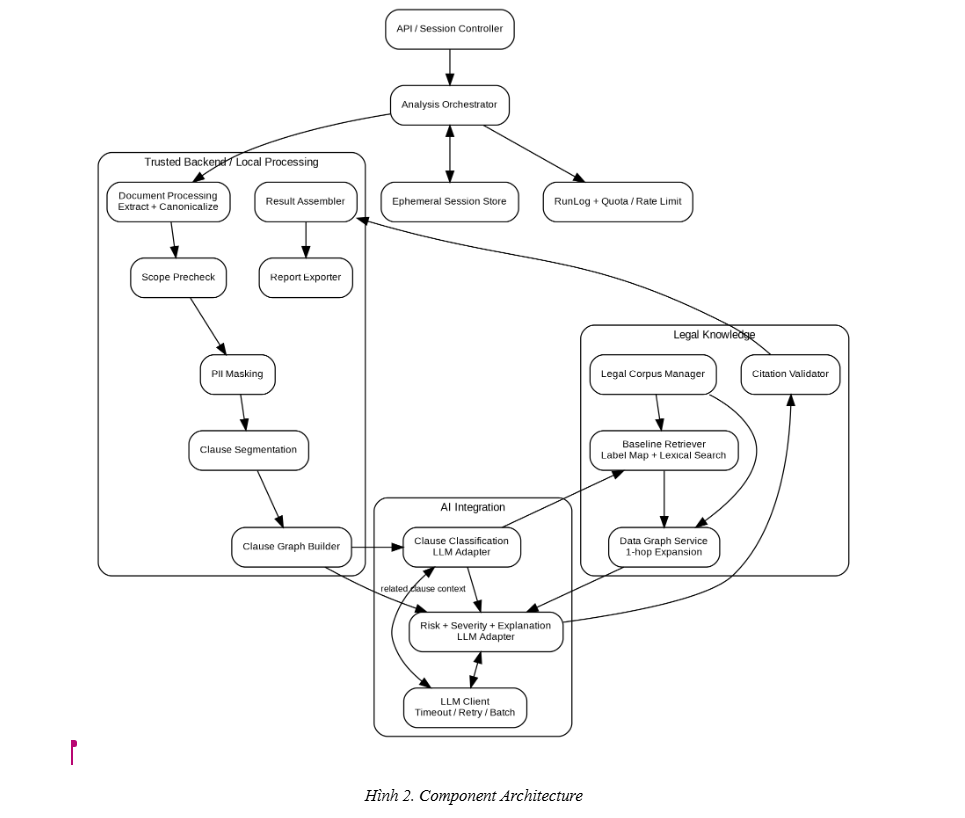

<!-- nguồn: SDD_AI_Labor_Contract_Risk_Analyzer_v0.2.md | mục: 3. Kiến trúc tổng thể | 3652 ký tự | trước: 03_2-system-context.md | sau: 05_4-pipeline-xu-ly-end-to-end.md -->

# 3. Kiến trúc tổng thể

Backend được thiết kế thành các module độc lập theo trách nhiệm nhưng chạy trong cùng một deployment. Analysis Orchestrator điều phối state machine và pipeline; các module local không phụ thuộc LLM.

*Hình 2. Component Architecture*

## 3.1 Phân rã component

| Component | Trách nhiệm | Ràng buộc |
|---|---|---|
| Web Frontend | Upload, chọn role, polling status, hiển thị canonical text/highlight, kết quả và export. | Không tự merge AI result hay tính span. |
| API / Session Controller | Nhận operation, tạo session_id, enforce SYSTEM_BUSY/rate/quota, expose status/result/retry/end. | Không chứa logic AI. |
| Analysis Orchestrator | Điều phối stage, state transition, retry, batch, version pinning và error mapping. | Nguồn điều phối duy nhất. |
| Ephemeral Session Store | Giữ session, canonical/masked text, clauses, Clause Graph, AI outputs tạm thời. | Không lưu bền vững; TTL 60 phút. |
| Document Processing | PDF/DOCX extraction, NFC normalization, reading order, header/footer/table handling. | Sinh canonical_text + extraction_version. |
| Scope Precheck | Luật cục bộ xác nhận tài liệu thuộc HĐLĐ. | Không gọi LLM. |
| PII Masker | Che PII trên toàn canonical text bằng placeholder cùng độ dài. | Không lưu mapping ngược. |
| Clause Segmenter | Tách clause bằng rule structural + paragraph fallback, backend tính span. | LLM segmentation chỉ là optional/cut item. |
| Clause Graph Builder | Dựng NEXT/PARENT_OF/REFERS_TO chỉ bằng clause_id. | Ephemeral, không chứa text. |
| Context Resolver | Chọn related clause cho từng target (REFERS_TO, PARENT_OF, NEXT trước và sau) cộng clause JOB_INFO, CONTRACT_TERM_TYPE làm context chung; backend lấy masked text tương ứng. | Không gọi LLM; ghi ContextResolutionTrace (EV-09). |
| Clause Classification Adapter | Batch masked clauses tới LLM, validate structured output. | LLM call #1. |
| Legal Corpus Manager | Load/validate corpus, version/effective dates, index và LegalEdge. | Fail fast khi corpus conflict. |
| Baseline Retriever | Label mapping + lexical search tạo seed candidates. | Hoạt động độc lập Data Graph. |
| Data Graph Service | Mở rộng/rank candidates tối đa 1 hop. | Có thể tắt; không sinh citation mới. |
| Risk Analysis Adapter | Risk labels, basis_type, explanation, citation selection và related_clause_ids từ candidates; không trả severity. | LLM call #2. |
| Citation Validator | Existence/version/candidate validation; log citation ngoài candidate. | Backend authoritative. |
| Taxonomy Validator và Severity Resolver | Kiểm (nhãn, basis_type, vai trò) theo risk taxonomy; tổ hợp sai thì retry có phản hồi một lần, vẫn sai thì phát bản ghi "cần xem xét"; severity do backend tra bảng, LLM không trả. | Bảng taxonomy trong mã là nguồn duy nhất. |
| Advice Linter | Lọc lời khuyên pháp lý khỏi phần giải thích (FR-17). | Backend authoritative. |
| Result Assembler | Join theo clause_id với original_text/span, dựng final response. | Không dùng masked text làm quote. |
| Report Exporter | Xuất DOCX/PDF theo khả năng đã chốt. | Không lưu report sau session. |
| LLM Client | Timeout 30s, auto-retry 1, model id bắt buộc, token/cost logging. | Gemini Flash paid tier demo/eval. |
| RunLog / Quota / Rate Limit | Metadata stage/call/token/cost/error; daily quota; rate limit theo IP. | Không log content/PII. |
| Cleanup Scheduler | Xóa phiên hết hạn (60 phút không hoạt động) và dữ liệu tạm; giữ bản ghi EXPIRED chỉ gồm session_id và status. | Không đọc nội dung phiên. |
| Evaluation Harness | Chạy pipeline như thư viện, không đi qua API/session; M1-M10/EV-08, EV-11. | Dữ liệu dev/test de-identify. |
