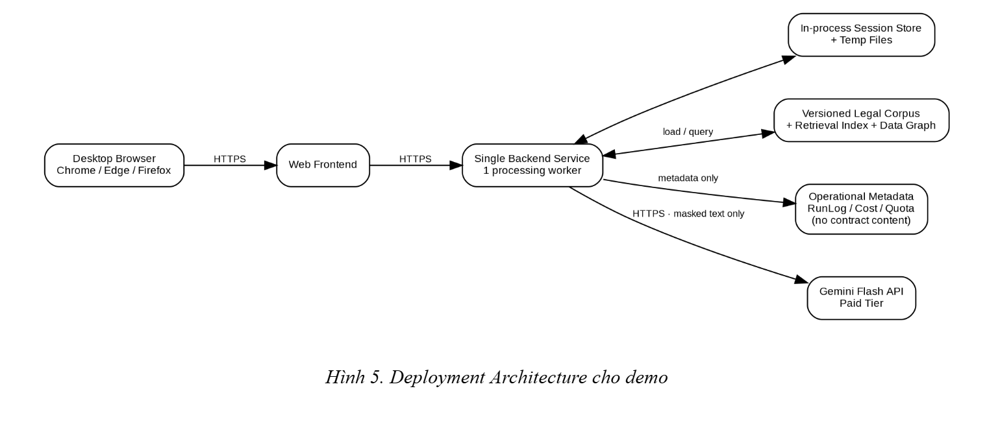

<!-- nguồn: SDD_AI_Labor_Contract_Risk_Analyzer_v0.2.md | mục: 13. Deployment Architecture | 819 ký tự | trước: 13_12-reliability-performance-va-cost.md | sau: 15_14-evaluation-architecture.md -->

# 13. Deployment Architecture

*Hình 5. Deployment Architecture cho demo*

SDD không khóa nhà cung cấp hosting. Deployment chỉ yêu cầu một web frontend và một backend service đơn, có HTTPS, temp storage và quyền đọc legal corpus artifacts. Không cần database chứa nội dung hợp đồng.

## 13.1 Startup sequence

1. Load configuration: model id, API key reference, timeout, quota/rate settings, graph enable flag.
2. Load clause/risk taxonomy + version metadata.
3. Load legal corpus; validate version overlap và citation IDs.
4. Build baseline retrieval index.
5. Build Data Graph adjacency index; nếu corpus/graph conflict thì startup/reload fail fast.
6. Khởi tạo in-memory Session Store, processing lock, RunLog/quota services.
7. Chỉ sau khi các bước trên thành công mới nhận upload.
